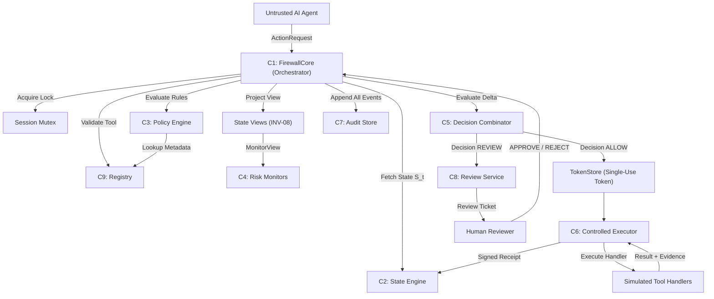
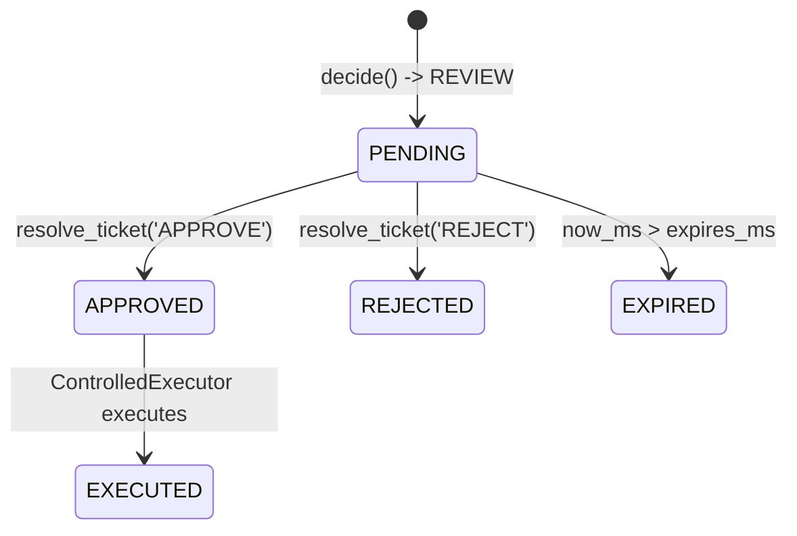
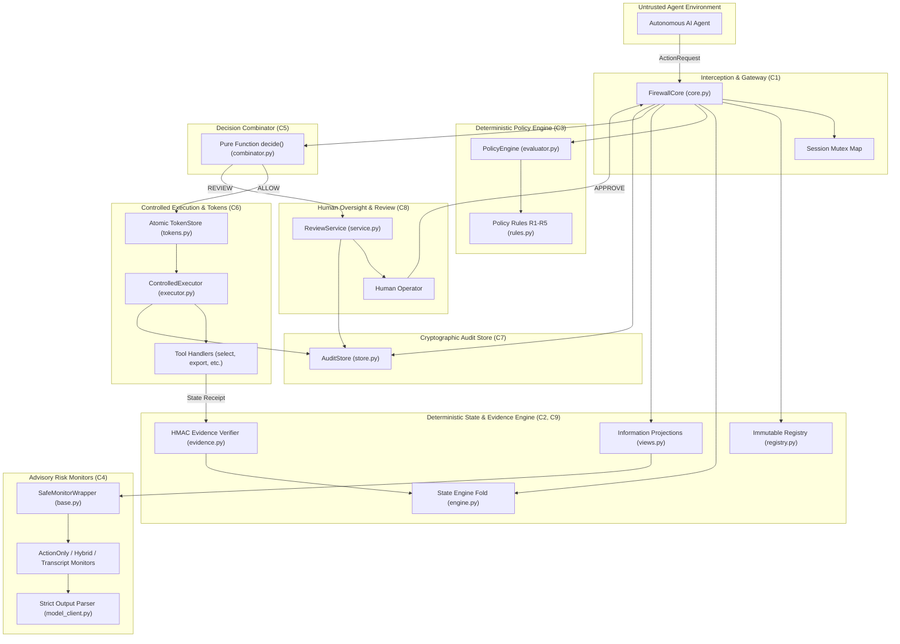
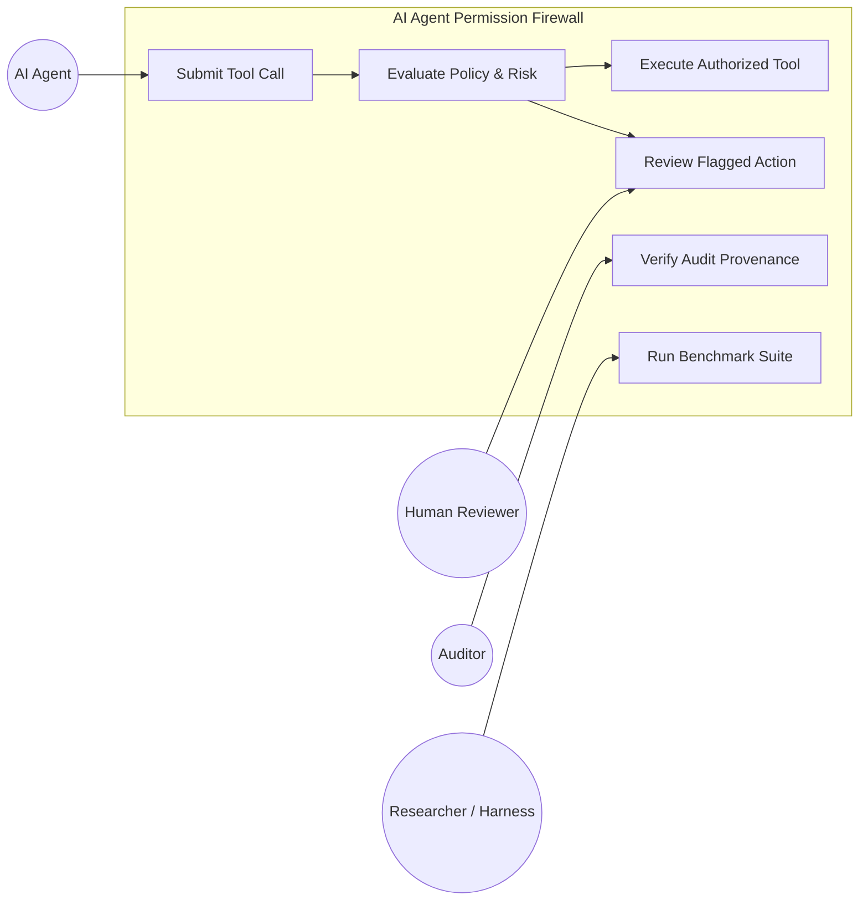
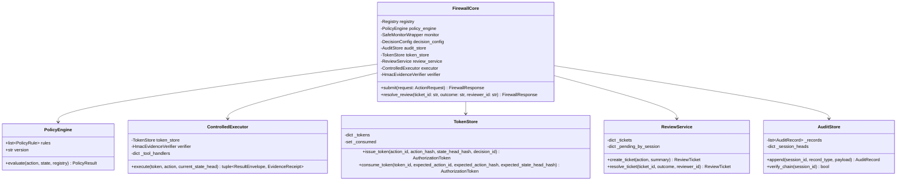
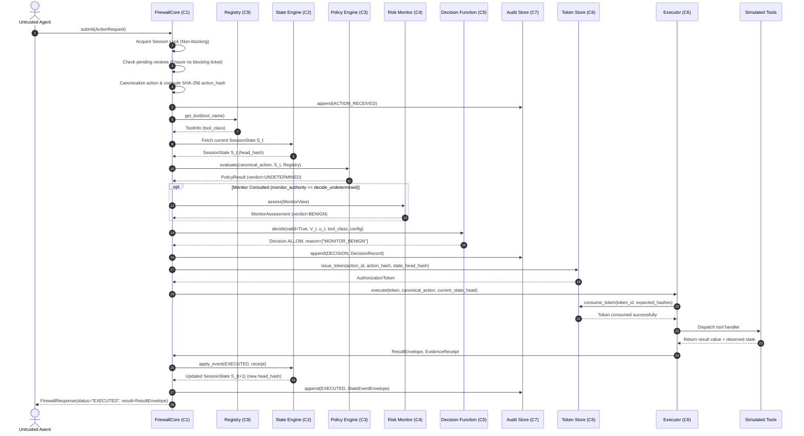
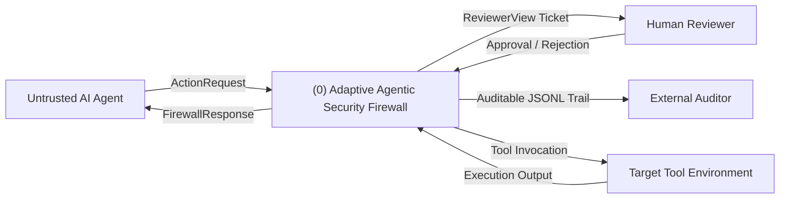
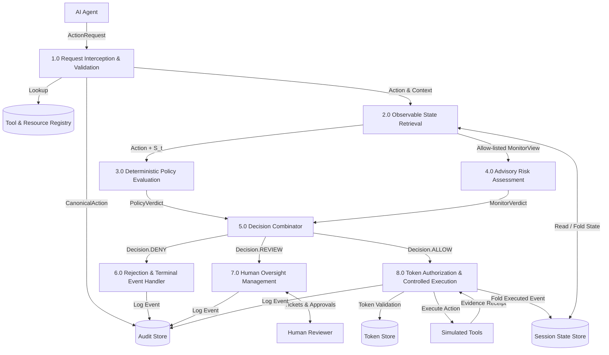
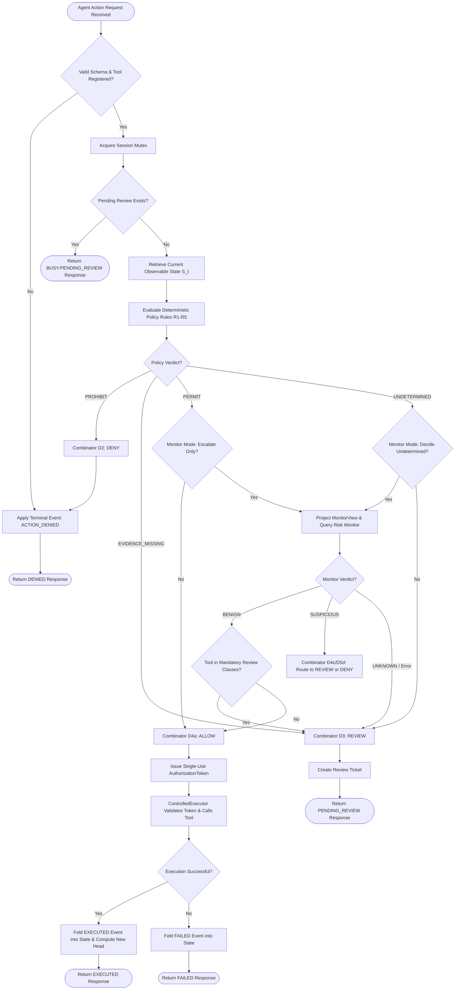

# TECHNICAL REPOSITORY INSPECTION REPORT
## Adaptive Agentic Security Firewall (AASF) / AI Agent Permission Firewall

**Academic Context:** B.Tech Final-Year Project Inspection & Architecture Audit  
**Institution:** Department of Computer Science & Engineering, Chhatrapati Shivaji Maharaj University, Navi Mumbai, Maharashtra, India  
**Project Guides:** Vikas Kumar, Shamshul Haque  
**Student Contributors / Subsystem Owners:**
- **Akshat Kasurde** (`akshatkasurde@gmail.com`): Interception Gateway ($C_1$), Controlled Executor ($C_6$), Adaptive Rejection Cascade (ASCP), CI/Packaging.
- **Karishma Thakur** (`karishwork101@gmail.com`): Deterministic Policy Engine ($C_3$), Authoritative Registries ($C_9$), Self-Adapting ABAC (SA-ABAC), Rules R1–R5.
- **Shrishti Singh** (`shrishtis089@gmail.com`): Observable State Engine ($C_2$), Risk Monitors ($C_4$), Information Barriers, Benchmark Runner ($C_{11}$).
- **Snehal Jagtap** (`snehaljagtap453@gmail.com`): Human Oversight & Review Service ($C_8$), Audit Store ($C_7$), Workload-Aware Dynamic Intervention (WA-DIF).

**Inspection Date:** November 02, 2026  
**Repository Path:** `c:\Users\karis\repo\ai-agent-permission-firewall`  
**Inspected Git Commit:** `cb208f9ca57939a9a50a3c98969ffe311f1432bf`  
**Active Branch:** `main`  
**Working Tree Status:** Clean  

---

## TABLE OF CONTENTS
1. [Repository Directory and File Structure](#1-repository-directory-and-file-structure)
2. [Source Code Modules and Inventory (`src/`)](#2-source-code-modules-and-inventory-src)
3. [Component Architecture and Class/Function Inventory](#3-component-architecture-and-classfunction-inventory)
4. [Runtime Firewall Request-Processing Workflow](#4-runtime-firewall-request-processing-workflow)
5. [Policy & Permission Engine](#5-policy--permission-engine)
6. [Runtime Gateway & Controlled Execution](#6-runtime-gateway--controlled-execution)
7. [Risk Monitoring Implementation](#7-risk-monitoring-implementation)
8. [State Management & Authorization Validation](#8-state-management--authorization-validation)
9. [Audit Logging, Cryptographic Integrity & Hashing](#9-audit-logging-cryptographic-integrity--hashing)
10. [Human Oversight & Review Ticket Workflow](#10-human-oversight--review-ticket-workflow)
11. [Dashboard Implementation Status](#11-dashboard-implementation-status)
12. [Configuration Files & Policy Definitions](#12-configuration-files--policy-definitions)
13. [Test Suites, Verification & Security Invariants](#13-test-suites-verification--security-invariants)
14. [Experiment Scripts, Benchmarks & Empirical Result Files](#14-experiment-scripts-benchmarks--empirical-result-files)
15. [CI/CD Pipeline & Automated Verification](#15-cicd-pipeline--automated-verification)
16. [Formal Specifications, Threat Model & Architecture Docs](#16-formal-specifications-threat-model--architecture-docs)

---

## REQUIRED FINAL-YEAR DELIVERABLES
- [Output A: Actual Implemented System Architecture](#output-a-actual-implemented-system-architecture)
- [Output B: Proposed System Workflow](#output-b-proposed-system-workflow)
- [Output C: Use Case Actors & Use Case Descriptions](#output-c-use-case-actors--use-case-descriptions)
- [Output D: Class Inventory (Attributes, Methods, Relationships)](#output-d-class-inventory-attributes-methods-relationships)
- [Output E: Sequence Diagram of a Complete Runtime Action Request](#output-e-sequence-diagram-of-a-complete-runtime-action-request)
- [Output F: Context-Level DFD (Level-0) & Level-1 DFD](#output-f-context-level-dfd-level-0--level-1-dfd)
- [Output G: Activity & Data-Flow Chart](#output-g-activity--data-flow-chart)
- [Output H: Actual Implementation Technology Stack](#output-h-actual-implementation-technology-stack)
- [Output I: Verbatim Python Source Code Excerpts](#output-i-verbatim-python-source-code-excerpts)
- [Output J: Project Limitations & Unimplemented / Planned Features](#output-j-project-limitations--unimplemented--planned-features)
- [Output K: Actual Project Timeline & Milestone Evolution](#output-k-actual-project-timeline--milestone-evolution)

---

## 1. Complete Repository Directory and File Structure

Below is the verified, comprehensive file tree of the repository at commit `cb208f9ca57939a9a50a3c98969ffe311f1432bf`. Internal Git structures (`.git/`), virtual environments (`.venv/`, `env/`), bytecode caches (`__pycache__/`, `*.pyc`), and local secrets (`.env`) are excluded.

```
ai-agent-permission-firewall/
├── .env.example                                      # Zero-byte template file
├── .gitignore                                        # Standard Python/Git ignore rules
├── CODEOWNERS                                        # Component code ownership mapping
├── pyproject.toml                                    # Build configuration, metadata, Ruff/Mypy/Pytest settings
├── README.md                                         # Minimal 1-line project title header
│
├── .github/
│   ├── CODEOWNERS                                    # GitHub mirrored codeowners
│   └── workflows/
│       └── ci.yml                                    # GitHub Actions CI workflow (lint, type-check, test)
│
├── config/                                           # Runtime Configuration Placeholders (All 0 bytes)
│   ├── firewall.yaml                                 # Gateway & combinator config placeholder
│   ├── policy_stateful.yaml                          # Stateful ABAC rules placeholder
│   ├── policy_stateless.yaml                         # Stateless rules placeholder
│   └── registry.yaml                                 # Tool & resource registry placeholder
│
├── docs/                                             # Formal Research & Engineering Documentation
│   ├── 00_RESEARCH_FOUNDATION.md                     # Terminology, literature basis, hypothesis formulations
│   ├── 01_THREAT_MODEL.md                            # Threat model, assets, invariants INV-01 to INV-12
│   ├── 02_SYSTEM_ARCHITECTURE.md                     # C1–C11 component specs, architectural diagrams
│   ├── 03_MATHEMATICAL_MODEL_AND_METRICS.md          # 3-valued policy logic, pure decision function Δ, metrics
│   ├── 04_PRD.md                                     # Product Requirements Document & functional requirements
│   ├── 05_TECHNICAL_SPEC.md                          # Schemas, interfaces, protocol contracts, data structures
│   ├── 06_EXPERIMENT_PROTOCOL.md                     # Empirical protocols, scenario taxonomy, baseline arms
│   ├── 07_REQUIREMENTS_TRACEABILITY.md               # Requirement-to-code traceability matrix
│   ├── 08_IMPLEMENTATION_ROADMAP.md                  # Phases 1 through 9, exit gates, risk mitigations
│   ├── 09_DECISIONS_AND_OPEN_QUESTIONS.md            # Architectural Decision Records (D-01 to D-37)
│   ├── C2_SECURITY_AUDIT.md                          # Forensic security audit of State Engine (SEC-01 to SEC-07)
│   ├── PROJECT_AUDIT.md                              # Historical phase completion status report
│   ├── rules.md                                      # Subsystem ownership & cross-testing protocol rules
│   ├── SEC_01_02_REMEDIATION_DESIGN.md               # Remediation specification for HMAC evidence verifier
│   ├── SHRISHTI_OWNERSHIP_AUDIT.md                   # Ownership breakdown for AI/ML & state evaluation
│   ├── prereg/
│   │   └── PREREG-001_DRAFT.md                       # Formal empirical pre-registration draft
│   └── research/
│       └── shrishti/                                 # Research artifacts, LaTeX paper, and raw calibration data
│           ├── runtime_risk_detection_ieee_reviewed_final.pdf
│           ├── runtime_risk_detection_ieee_reviewed_final.tex
│           └── runtime-risk-experiment/              # Independent pilot study runner & calibration logs
│               ├── BASELINE_FAIRNESS_AUDIT.md
│               ├── BASELINE_GENERALIZATION_AUDIT.md
│               ├── OBSERVABLE_BASELINE_EVALUATION.md
│               ├── PAPER_READINESS_AUDIT.md
│               ├── README.md
│               ├── calibration_config.json
│               ├── run_scenario2_pilot.py
│               ├── scenario2_config.json
│               ├── smoke_test.py
│               ├── verify_v11.py
│               ├── context/                          # Generator for benign/adversarial context
│               ├── context_position_experiment/      # Pilot runner scripts & diagnostic protocols
│               ├── detector/                         # Pilot detector monitor implementations
│               ├── environment/                      # Simulated pilot tool environment
│               ├── experiments/                      # Pilot experiment runners
│               ├── results/                          # Historical calibration runs (run006 through run011)
│               ├── scenarios/                        # Scenario specifications (data exposure, pipeline audit)
│               └── tests/                            # Unit tests for pilot scripts
│
├── experiments/                                      # Benchmark & Empirical Evaluation Pipeline
│   ├── evaluate.py                                   # Standalone evaluation entrypoint (0 bytes)
│   ├── metrics.py                                    # Canonical evaluation metrics calculation module
│   ├── run_experiment.py                             # Automated runner entrypoint (0 bytes)
│   ├── stats.py                                      # Statistical analysis, uncertainty quantification, power
│   ├── results/                                      # Saved Experimental Datasets & Empirical Outputs
│   │   ├── ablation_results.csv                      # Ablation study run data (N=100)
│   │   ├── results.csv                               # Benchmark run data (N=300)
│   │   └── results_full_study.csv                    # Full empirical study raw outcomes (N=2,790 records)
│   └── scripts/                                      # Data Generation, Analysis, & Verification Scripts
│       ├── ablation_study.py                         # Generates and tests ablation dataset via Ollama
│       ├── adaptive_security_test.py                 # Benchmarks Fixed-Cheap, Fixed-Deep, Adaptive-Depth
│       ├── analyze_ablation.py                       # Computes ablation metrics and summary tables
│       ├── audit_routing.py                          # Audits adaptive routing decisions
│       ├── count_dataset.py                          # Counts records across dataset splits
│       ├── deep_dive_reconciliation.py               # Reconciles execution anomalies
│       ├── final_analysis.py                         # Statistical aggregations for research papers
│       ├── final_category_audit.py                   # Categorizes tool invocations by risk class
│       ├── final_category_breakdown.py               # Category-level breakdown tables
│       ├── final_latency_stats.py                    # Latency percentiles calculation
│       ├── final_validation.py                       # Validates dataset integrity and schemas
│       ├── forensic_analysis.py                      # Forensic trace inspection
│       ├── generate_dataset_v1.py                    # Synthetic dataset generation pipeline v1
│       ├── generate_pilot_dataset.py                 # Pilot dataset generator
│       ├── migrate_dataset.py                        # Dataset migration utility
│       ├── reconcile_logs.py                         # Reconciles audit logs against run outputs
│       ├── routing_audit.py                          # Routing audit checks
│       ├── routing_tests.py                          # Routing logic unit assertions
│       ├── run_exp_002.py                            # Experiment runner script 002
│       ├── verify_category_invocations.py            # Verifies tool call categorization
│       └── verify_samples.py                         # Dataset sample spot-check utility
│
├── legacy/                                           # Legacy & Historical Implementations (Superseded)
│   ├── firewall/                                     # Historical monolithic prototype (state, schemas)
│   └── fw/                                           # Historical stub packages (gateway, orchestrator)
│
├── RESEARCH_PAPER/                                   # Individual B.Tech Research Paper Manuscripts
│   ├── AKSHAT_RP.md                                  # Paper by Akshat Kasurde (Adaptive Rejection Cascade)
│   ├── KARISHMA_RP.md                                # Paper by Karishma Thakur (Self-Adapting ABAC)
│   ├── SHRISTI_RP.md                                 # Paper by Shrishti Singh (State vs. Context in LLM Monitors)
│   └── SNEHAL_RP.md                                  # Paper by Snehal Jagtap (Workload-Aware Dynamic Oversight)
│
├── results/                                          # Git-tracked placeholder for runtime output artifacts
│   └── .gitkeep
│
├── scripts/                                          # Automation & Security Enforcement Scripts
│   └── ci_check_no_labels.py                         # Enforces INV-08 (no ground-truth labels tracked in Git)
│
├── src/                                              # Production Source Code
│   ├── firewall/                                     # Canonical Implementation Package (Connected & Tested)
│   │   ├── __init__.py                               # Package exports
│   │   ├── core.py                                   # Central Orchestration Engine (FirewallCore)
│   │   ├── audit/                                    # Append-Only Hash-Chained Audit Store (C7)
│   │   │   ├── __init__.py
│   │   │   └── store.py                              # AuditStore & AuditRecord implementation
│   │   ├── contracts/                                # Shared Domain Contracts & RFC 8785 Hashing
│   │   │   ├── __init__.py
│   │   │   ├── enums.py                              # Enumerations: Decision, Verdict, ToolClass, Zone, etc.
│   │   │   ├── hashing.py                            # RFC 8785 canonical JSON bytes & SHA-256 action hashing
│   │   │   └── models.py                             # Pydantic v2 models: ActionRequest, SessionState, etc.
│   │   ├── decision/                                 # Pure Deterministic Decision Combinator (C5)
│   │   │   ├── __init__.py
│   │   │   └── combinator.py                         # Pure decision function Δ(valid, V_t, u_t, c, κ)
│   │   ├── executor/                                 # Controlled Execution Gateway & Token Store (C6)
│   │   │   ├── __init__.py
│   │   │   ├── executor.py                           # ControlledExecutor with simulated tool handlers
│   │   │   └── tokens.py                             # Single-use atomic TokenStore
│   │   ├── monitor/                                  # Advisory Runtime Risk Monitors (C4)
│   │   │   ├── __init__.py
│   │   │   ├── action_only.py                        # ActionOnlyMonitor implementation
│   │   │   ├── base.py                               # Monitor protocol & SafeMonitorWrapper
│   │   │   ├── hybrid.py                             # HybridMonitor implementation
│   │   │   ├── mock.py                               # MockMonitor for testing & fault injection
│   │   │   ├── model_client.py                       # ModelClient protocol & strict JSON output parser
│   │   │   └── transcript.py                         # TranscriptMonitor implementation
│   │   ├── oversight/                                # Human Oversight & Review Service (C8)
│   │   │   ├── __init__.py
│   │   │   └── service.py                            # ReviewService managing review ticket lifecycle
│   │   ├── policy/                                   # Deterministic Three-Valued Policy Engine (C3)
│   │   │   ├── __init__.py
│   │   │   ├── evaluator.py                          # PolicyEngine with 3-valued Kleene evaluation
│   │   │   └── rules.py                              # PolicyRule, Condition models & default rules R1–R5
│   │   ├── schemas/                                  # Compatibility Re-export Facade
│   │   │   ├── __init__.py
│   │   │   ├── enums.py                              # Alias to contracts.enums
│   │   │   ├── hashing.py                            # Alias to contracts.hashing
│   │   │   ├── models.py                             # Alias to contracts.models
│   │   │   └── policy.py                             # Alias to policy.rules
│   │   └── state/                                    # Deterministic State Engine & Registries (C2, C9)
│   │       ├── __init__.py
│   │       ├── engine.py                             # State transition fold Φ(H_t, Registry) & head hash
│   │       ├── errors.py                             # StateIntegrityError, StateContinuityError, etc.
│   │       ├── evidence.py                           # HmacEvidenceVerifier (HMAC-SHA256 receipt validation)
│   │       ├── registry.py                           # Immutable in-memory Registry (tools, resources, zones)
│   │       └── views.py                              # Allow-listed projections (PolicyView, MonitorView, ReviewerView)
│   │
│   └── fw/                                           # Legacy / Deprecated Compatibility Stub Package
│       ├── __init__.py                               # Aliases sys.modules["fw"] = firewall
│       ├── core.py                                   # 0 bytes (Empty stub)
│       ├── audit/__init__.py                         # 0 bytes
│       ├── contracts/                                # Minimal divergent contract models
│       ├── state/__init__.py                         # 0 bytes
│       └── tools_sim/__init__.py                     # 0 bytes
│
└── tests/                                            # Verification & Test Suite (262 Test Methods)
    ├── golden/
    │   └── contracts_schema_snapshot.json            # Byte-for-byte JSON Schema snapshot of Pydantic models
    ├── integration/
    │   └── test_firewall_core.py                     # Full end-to-end integration tests of FirewallCore
    ├── invariants/
    │   ├── test_security_invariants_contracts.py     # Invariant tests on schema stability & immutability
    │   └── test_security_invariants_state.py         # Invariant tests: INV-04, INV-07, INV-08, INV-12
    ├── property/
    │   └── test_hashing_properties.py                # Hypothesis property-based tests for hashing stability
    └── unit/
        ├── test_audit.py                             # Unit tests for AuditStore & hash chaining
        ├── test_ci_label_leakage.py                  # Unit tests for CI label isolation rule
        ├── test_contracts.py                         # Unit tests for Pydantic models & validation rules
        ├── test_decision.py                          # Unit tests for pure decision combinator rules D1–D5
        ├── test_executor.py                          # Unit tests for ControlledExecutor & token consumption
        ├── test_hashing.py                           # Unit tests for RFC 8785 canonical JSON bytes
        ├── test_metrics.py                           # Unit tests for evaluation metrics calculations
        ├── test_monitors.py                          # Unit tests for monitors & strict JSON parser
        ├── test_oversight.py                         # Unit tests for ReviewService ticket lifecycle
        ├── test_policy.py                            # Unit tests for PolicyEngine & 3-valued logic
        ├── test_schema_snapshot.py                   # Golden snapshot byte-for-byte comparison test
        ├── test_state_engine.py                      # Unit tests for State Engine fold & HMAC evidence
        └── test_stats.py                             # Unit tests for statistical analysis & bootstrap power
```

---

## 2. Source Code Modules and Inventory (`src/`)

The active codebase resides under `src/firewall/`. The directory `src/fw/` is an incomplete legacy stub.

### 2.1 File Metrics Table
| Relative File Path | Byte Size | Lines | Subsystem Role | Owner |
|---|---|---|---|---|
| `src/firewall/core.py` | 21,251 | 530 | Central Orchestration Gateway ($C_1$) | Akshat |
| `src/firewall/contracts/enums.py` | 3,715 | 139 | Shared Enumeration Types | Shared (All 4) |
| `src/firewall/contracts/hashing.py` | 3,468 | 114 | RFC 8785 Canonical JSON & SHA-256 Hashes | Shared (All 4) |
| `src/firewall/contracts/models.py` | 7,550 | 270 | Shared Pydantic v2 Domain Models | Shared (All 4) |
| `src/firewall/policy/evaluator.py` | 7,583 | 208 | 3-Valued Deterministic Policy Engine ($C_3$) | Karishma |
| `src/firewall/policy/rules.py` | 8,027 | 232 | Rule Definitions & Default Rules R1–R5 | Karishma |
| `src/firewall/decision/combinator.py` | 6,077 | 126 | Pure Deterministic Decision Function ($C_5$) | Karishma & Akshat |
| `src/firewall/state/engine.py` | 20,214 | 508 | Observable State Engine Fold $\Phi$ ($C_2$) | Shrishti |
| `src/firewall/state/registry.py` | 7,084 | 180 | Immutable Registries for Tools/Resources ($C_9$) | Karishma |
| `src/firewall/state/evidence.py` | 10,558 | 240 | HMAC-SHA256 Evidence Receipt Verifier | Shrishti |
| `src/firewall/state/views.py` | 7,445 | 194 | Allow-listed Information Projections (INV-08) | Shrishti |
| `src/firewall/state/errors.py` | 1,094 | 43 | State Engine Custom Exception Types | Shrishti |
| `src/firewall/executor/executor.py` | 6,883 | 171 | Controlled Tool Execution Gateway ($C_6$) | Akshat |
| `src/firewall/executor/tokens.py` | 4,786 | 138 | Single-Use Authorization Token Store ($C_6$) | Akshat |
| `src/firewall/monitor/base.py` | 3,022 | 90 | Monitor Protocol & Safe Fault Wrapper ($C_4$) | Shrishti |
| `src/firewall/monitor/model_client.py` | 8,515 | 248 | ModelClient Protocol & Strict JSON Parser | Shrishti |
| `src/firewall/monitor/action_only.py` | 5,817 | 148 | Action-Only Risk Monitor (B4) | Shrishti |
| `src/firewall/monitor/hybrid.py` | 10,165 | 246 | Hybrid State-Aware Risk Monitor (P1) | Shrishti |
| `src/firewall/monitor/transcript.py` | 5,828 | 144 | Full-Transcript Risk Monitor (B5) | Shrishti |
| `src/firewall/monitor/mock.py` | 1,896 | 65 | Configurable Mock Monitor for Unit Tests | Shrishti |
| `src/firewall/oversight/service.py` | 6,460 | 173 | Human Review Ticket Lifecycle Manager ($C_8$) | Snehal |
| `src/firewall/audit/store.py` | 4,466 | 135 | Append-Only Hash-Chained Audit Store ($C_7$) | Snehal |
| `src/firewall/schemas/*.py` | 1,646 | 65 | Facade aliases to contracts & policy | Shared |
| `src/fw/core.py` | 0 | 0 | Unimplemented legacy stub | Deprecated |
| `src/fw/contracts/*.py` | 2,094 | 92 | Outdated divergent contract models | Deprecated |

---

## 3. Component Architecture and Class/Function Inventory

The system is partitioned into nine active trusted components ($C_1$ through $C_9$), plus experimental and testing harnesses.



---

## 4. Runtime Firewall Request-Processing Workflow

When an untrusted autonomous agent proposes an action, `FirewallCore.submit(request: ActionRequest)` mediates the request through a strict 10-step pipeline:

```
[Agent ActionRequest]
         │
         ▼
[Step 1: Session Concurrency Lock] ──(Busy)──► Return BUSY:ACTION_IN_FLIGHT
         │
         ▼
[Step 2: Pending Review Check] ──────(Pending)─► Return BUSY:PENDING_REVIEW
         │
         ▼
[Step 3: Canonicalization & Monotonic Sequencing]
  - Assign server-controlled action_id (act_xxxxxxxxxxxx)
  - Increment session action sequence number
  - Compute SHA-256 action_hash = H(session_id || seq || tool || canonical_json(arguments))
  - Append ACTION_RECEIVED to AuditStore
         │
         ▼
[Step 4: Registry Validation] ───────(Unknown Tool)─► Fail-closed: DENY (UNKNOWN_TOOL)
         │
         ▼
[Step 5: Observable State Retrieval]
  - Retrieve or initialize SessionState S_t = Φ(H_t, Registry)
         │
         ▼
[Step 6: Deterministic Policy Evaluation]
  - PolicyEngine.evaluate(canonical_action, S_t, Registry)
  - Returns V_t ∈ {PROHIBIT, EVIDENCE_MISSING, PERMIT, UNDETERMINED}
         │
         ▼
[Step 7: Advisory Monitor Gating & Assessment]
  - Check cfg.monitor_authority:
    • escalate_only: Consult monitor only if V_t == PERMIT
    • decide_undetermined: Consult monitor only if V_t == UNDETERMINED
    • none: Do not consult monitor
  - Build allow-listed MonitorView (Information barrier INV-08)
  - SafeMonitorWrapper.assess(view) -> u_t ∈ {BENIGN, SUSPICIOUS, UNKNOWN}
         │
         ▼
[Step 8: Pure Decision Combination]
  - decide(valid=True, policy_verdict=V_t, monitor_verdict=u_t, tool_class, config)
  - Returns D_t ∈ {ALLOW, DENY, REVIEW} and reason codes
         │
         ▼
[Step 9: Hash-Chained Audit Append]
  - Append DECISION to AuditStore before any external action execution
         │
         ▼
[Step 10: Outcome Processing]
  ├── ALLOW  ──► Issue AuthorizationToken ──► ControlledExecutor.execute()
  │               ├── Success: apply_event(EXECUTED) ──► Return FirewallResponse(EXECUTED)
  │               └── Failure: apply_event(FAILED)   ──► Return FirewallResponse(FAILED)
  ├── REVIEW ──► Build ReviewerView ──► ReviewService.create_ticket() ──► Return FirewallResponse(PENDING_REVIEW)
  └── DENY   ──► apply_event(ACTION_DENIED) ──► Return FirewallResponse(DENIED)
```

---

## 5. Policy & Permission Engine

Located in `src/firewall/policy/evaluator.py` and `rules.py`.

### 5.1 Three-Valued Logic (Kleene Logic)
Conditions evaluate against `SessionState`, `CanonicalAction` arguments, or `Registry` metadata to a three-valued logic state `TriBool`:
* `TRUE`: Condition holds unconditionally.
* `FALSE`: Condition is violated.
* `UNKNOWN`: Security-relevant evidence is absent (missing attribute, unset destination, or explicit `UNKNOWN` classification/zone).

### 5.2 Verdict Aggregation & Precedence
Rules are grouped into `PROHIBIT` and `PERMIT`. Evaluation enforces strict mathematical precedence:
$$\text{PROHIBIT} \succ \text{EVIDENCE\_MISSING} \succ \text{PERMIT} \succ \text{UNDETERMINED}$$

```python
# Evaluated strictly in order:
if matched_prohibits:
    return PolicyResult(verdict=PolicyVerdict.PROHIBIT, matched_rules=matched_prohibits)
if maybe_prohibits:
    return PolicyResult(verdict=PolicyVerdict.EVIDENCE_MISSING, maybe_rules=maybe_prohibits, missing_fields=missing_fields)
if matched_permits:
    return PolicyResult(verdict=PolicyVerdict.PERMIT, matched_rules=matched_permits)
return PolicyResult(verdict=PolicyVerdict.UNDETERMINED)
```

### 5.3 Canonical Benchmark Rules Implemented in `create_default_stateful_policy()`
1. **Rule R1 (`R1-no-confidential-external-export`)**: `PROHIBIT execute_export` when `state.bound_resource.classification == CONFIDENTIAL` and `state.destination.zone == EXTERNAL`.
2. **Rule R2 (`R2-permit-public-external-export`)**: `PERMIT execute_export` when `state.bound_resource.classification == PUBLIC`, `state.destination.zone == EXTERNAL`, and `state.job_created == True`.
3. **Rule R3 (`R3-permit-internal-export`)**: `PERMIT execute_export` when `state.destination.zone == INTERNAL`.
4. **Rule R4 (`R4-agents-cannot-relabel`)**: `PROHIBIT relabel_resource` unconditionally.
5. **Rule P-filler (`P-filler-read-low`)**: `PERMIT` any tool with `tool_class == ToolClass.READ_LOW`.
6. **Setup Rules**: `PERMIT select_resource`, `PERMIT create_export_job`, `PERMIT configure_destination`, `PERMIT reset_context`.

---

## 6. Runtime Gateway & Controlled Execution

Located in `src/firewall/executor/executor.py` and `tokens.py`.

### 6.1 Cryptographic Single-Use Tokens
Execution requires an `AuthorizationToken` generated by `TokenStore.issue_token()` containing:
- `token_id`: Cryptographically random identifier (`tok_xxxxxxxxxxxx`).
- `action_id` and `action_hash`: Cryptographically bound to the exact canonical action.
- `state_head_hash`: Bound to the current state-head hash $H_t$ of the session.
- `decision_id`: Bound to the specific audit decision record.
- `nonce`: Random 128-bit hex string.
- `expires_at_ms`: Monotonic timestamp boundary (default TTL = 60,000 ms).

### 6.2 Atomic Token Consumption
`TokenStore.consume_token()` operates under a thread lock:
1. Verifies token existence in `_tokens`.
2. Verifies token is not in `_consumed` (rejects replay attacks with `TokenReusedError`, enforcing INV-06).
3. Verifies `action_id`, `action_hash`, and `state_head_hash` match expected parameters (rejects TOCTOU/race conditions with `TokenBindingMismatchError`, enforcing INV-02).
4. Verifies `now_ms <= expires_at_ms` (rejects expired tokens with `TokenExpiredError`).
5. Moves `token_id` into `_consumed`.

---

## 7. Risk Monitoring Implementation

Located in `src/firewall/monitor/`.

### 7.1 Pluggable Monitors
- **ActionOnlyMonitor (`action_only.py`)**: Assesses only proposed tool name, arguments, goal, and policy text.
- **TranscriptMonitor (`transcript.py`)**: Assesses full serialized text transcript of prior session events.
- **HybridMonitor (`hybrid.py`)**: Assesses allow-listed typed state summaries ($S_t$) with prior event references.
- **MockMonitor (`mock.py`)**: Deterministic test double returning configured verdicts, scores, and artificial latencies.

### 7.2 Safe Fault-Isolation Wrapper
`SafeMonitorWrapper` wraps all monitor calls. If a monitor raises an unhandled exception, encounters an unexpected JSON format, or times out, the wrapper intercepts the fault and converts the result to `MonitorVerdict.UNKNOWN` (enforcing fail-closed invariant INV-04).

### 7.3 Strict JSON Output Parser
Implemented in `model_client.py`:
- Enforces strict canonical JSON: `{"verdict": "BENIGN" | "SUSPICIOUS" | "UNKNOWN", "confidence": float, "reasoning": str}`.
- Rejects unexpected extra keys, missing keys, prose preambles, and boolean types masquerading as floats.
- Throws `MonitorOutputParseError` on any discrepancy.

---

## 8. State Management & Authorization Validation

Located in `src/firewall/state/engine.py` and `evidence.py`.

### 8.1 State Transition as a Pure Fold
Session state is computed deterministically:
$$S_t = \Phi(H_t, \text{Registry})$$
`apply_event(state, event, registry, binding_mode, verifier)` executes without side effects:
- Evaluates `StateEventEnvelope` or legacy `Event`.
- Validates sequence monotonicity ($seq_{t} = seq_{t-1} + 1$).
- Updates resource selections, export jobs, and destinations.
- Maintains cumulative egress counters (`rows`, `bytes`).
- Detects anomalies (`CONFLICTING_SELECTION`, `UNKNOWN_CLASSIFICATION`, `UNKNOWN_DESTINATION`).

### 8.2 Tamper-Evident State-Head Hash Chain
Every state update computes an SHA-256 hash chaining the previous head hash with RFC 8785 canonical JSON bytes of the event:
$$head\_hash_t = \text{SHA-256}(head\_hash_{t-1} \parallel \text{canonical\_json}(event\_data))$$

### 8.3 Cryptographic Evidence Receipts (HMAC-SHA256)
`HmacEvidenceVerifier` validates receipts generated by tool executions:
$$\text{Signature} = \text{HMAC-SHA256}(K, \text{canonical\_json}(\text{receipt\_fields}))$$
Receipt verification checks:
1. Cryptographic HMAC authenticity.
2. Exact match of `session_id`, `action_id`, `token_id`, and `source_tool_name`.
3. Observation schema structure (`rows >= 0`, `bytes >= 0`).
4. Replay protection (rejects previously processed receipts).

---

## 9. Audit Logging, Cryptographic Integrity & Hashing

Located in `src/firewall/audit/store.py` and `contracts/hashing.py`.

### 9.1 RFC 8785 Canonical JSON Serialization
`canonical_json(obj, reject_floats=False)` implements deterministic canonical JSON:
- Formats dictionaries with UTF-8 lexicographical key sorting.
- Strips whitespace between separators (`","` and `":"`).
- Canonicalizes integers and strings.
- Floats can be optionally rejected to prevent platform-dependent IEEE 754 precision drift.

### 9.2 Append-Only Cryptographic Audit Log
`AuditStore` maintains an in-memory SHA-256 hash chain per session:
$$\text{hash}_i = \text{SHA-256}(\text{hash}_{i-1} \parallel \text{canonical\_json}(\text{payload}_i))$$
- `rec_id`: Global monotonic integer identifier.
- `session_id`: Isolated per agent session.
- `seq`: Per-session monotonic sequence number.
- `prev_hash`: Parent record hash.
- `hash`: Current record hash.
- `mono_ns`: Monotonic hardware timestamp (`time.perf_counter_ns()`).

---

## 10. Human Oversight & Review Ticket Workflow

Located in `src/firewall/oversight/service.py` and `core.py`.

### 10.1 Ticket Lifecycle


### 10.2 Review Ticket Service Rules
- When a decision produces `REVIEW`, `ReviewService.create_ticket()` issues a ticket with a 300,000 ms TTL.
- `_pending_by_session` blocks subsequent session submissions with `BUSY:PENDING_REVIEW`.
- Re-resolving an already resolved or expired ticket raises `TicketAlreadyResolvedError` or `TicketExpiredError`.

---

## 11. Dashboard Implementation Status

### **STATUS: NOT FOUND (Explicitly Deferred)**
* **Verification**: Exhaustive search across `src/`, `tests/`, and `config/` reveals **0 frontend, web UI, or dashboard implementation files**.
* **Documented Deferral**:
  - `docs/04_PRD.md`: `FR-DASH-01` (Audit/metrics dashboard) is classified as Priority **Deferred (D)** to Phase 9.
  - `docs/08_IMPLEMENTATION_ROADMAP.md`: Section Phase 9 explicitly defers the dashboard to prevent scope creep.
  - `docs/09_DECISIONS_AND_OPEN_QUESTIONS.md`: Decision `D-06` and `D-28` confirmed unanimous approval to defer dashboard implementation.
  - `docs/PROJECT_AUDIT.md`: Dashboard & Oversight UI is recorded as **0% complete / Deferred**.

---

## 12. Configuration Files & Policy Definitions

Located in `config/`:
- `config/firewall.yaml` (0 bytes)
- `config/policy_stateful.yaml` (0 bytes)
- `config/policy_stateless.yaml` (0 bytes)
- `config/registry.yaml` (0 bytes)

**Implementation Reality**:
The repository intentionally decouples runtime transition logic from file-based YAML parsing (`src/firewall/state/registry.py` line 6). All active configurations, policy rules, and registries are constructed **programmatically via Python classes** (`Registry()`, `create_default_stateful_policy()`, `DecisionConfig()`).

---

## 13. Test Suites, Verification & Security Invariants

### 13.1 Test Suite Breakdown (262 Test Methods across 17 Files)
| Test Suite Path | Test Count | Target Subsystem |
|---|:---:|---|
| `tests/integration/test_firewall_core.py` | 15 | Full end-to-end request lifecycle & review flows |
| `tests/invariants/test_security_invariants_contracts.py` | 3 | Contract immutability & schema stability |
| `tests/invariants/test_security_invariants_state.py` | 5 | Security invariants INV-04, INV-07, INV-08, INV-12 |
| `tests/property/test_hashing_properties.py` | 2 | Hypothesis property tests for canonical hashing |
| `tests/unit/test_audit.py` | 3 | AuditStore append-only hash chaining |
| `tests/unit/test_ci_label_leakage.py` | 4 | Verification of label isolation scripts |
| `tests/unit/test_contracts.py` | 9 | Pydantic validation & forbidden extra fields |
| `tests/unit/test_decision.py` | 9 | Decision combinator D1–D5 branches |
| `tests/unit/test_executor.py` | 4 | ControlledExecutor token check & tool execution |
| `tests/unit/test_hashing.py` | 7 | RFC 8785 canonical JSON bytes |
| `tests/unit/test_metrics.py` | 83 | Evaluation metrics & confusion matrix utilities |
| `tests/unit/test_monitors.py` | 38 | Monitor view projections & strict JSON parser |
| `tests/unit/test_oversight.py` | 4 | Review ticket lifecycle & expiry |
| `tests/unit/test_policy.py` | 8 | PolicyEngine 3-valued logic & rule precedence |
| `tests/unit/test_schema_snapshot.py` | 1 | Byte-for-byte JSON Schema golden snapshot |
| `tests/unit/test_state_engine.py` | 32 | State fold transitions & HMAC receipt validation |
| `tests/unit/test_stats.py` | 35 | Statistical confidence intervals & power analysis |

### 13.2 Security Invariant Verification Matrix (INV-01 to INV-12)
| Invariant | Description | Enforcement Point | Verified? |
|---|---|---|:---:|
| **INV-01** | Complete Mediation | `FirewallCore.submit()` / `ControlledExecutor` | Yes |
| **INV-02** | Decision-Action Binding | `TokenStore.consume_token()` checks action hash & state head | Yes |
| **INV-03** | Prohibition Supremacy | `PolicyEngine.evaluate()` & `decide()` D2 branch | Yes |
| **INV-04** | Fail-Closed on Faults | `SafeMonitorWrapper`, `decide()` D3/D4d/D5e branches | Yes |
| **INV-05** | REVIEW Non-Authorization | `decide()` D5a/c/e creates ticket without token | Yes |
| **INV-06** | Single-Use Authorization | `TokenStore.consume_token()` single-use check | Yes |
| **INV-07** | Evidence Provenance Barrier | `apply_event()` ignores untrusted free text & agent claims | Yes |
| **INV-08** | Label & Test Isolation | `src/firewall/state/views.py` information barriers | Yes |
| **INV-09** | Audit Completeness & Tamper Evidence | `AuditStore` append-only SHA-256 hash chain | Yes |
| **INV-10** | Versioned Decisions | `DecisionRecord.versions` records version hashes | Yes |
| **INV-11** | Monotone Strictness | `decide()` pure decision lattice ordering | Yes |
| **INV-12** | Deterministic Core & Replay | `initial_state()` & `apply_event()` pure fold | Yes |

---

## 14. Experiment Scripts, Benchmarks & Empirical Result Files

### 14.1 Saved Empirical Datasets
Located in `experiments/results/`:
1. `results_full_study.csv` (119.8 KB, 2,790 records): Complete trial data across `Fixed-Cheap` (`llama3.2:latest`), `Fixed-Deep` (`llama3:latest`), and `Adaptive-Depth` cascaded routing. Columns: `id, group, label, decision, latency`.
2. `results.csv` (14.4 KB, 300 records): Summary benchmark trials comparing filter-bypass and latency.
3. `ablation_results.csv` (17.5 KB, 400 records): Prompt variations (`professional`, etc.) across cheap and adaptive guardrails.

### 14.2 Empirical Metrics & Statistics Modules
- `experiments/metrics.py`: Computes TPR, TNR, FPR, FNR, precision, recall, F1, latency percentiles (p50, p90, p95, p99), and review burden.
- `experiments/stats.py`: Implements Wilson score intervals, Clopper-Pearson intervals, bootstrap confidence intervals, McNemar tests, and sample size calculations.

---

## 15. CI/CD Pipeline & Automated Verification

Configured in `.github/workflows/ci.yml`:
1. **Linting**: `ruff check .` (enforces line length 100, rules E, F, W, I, B).
2. **Type Checking**: `mypy src tests` (strict type checking with `disallow_untyped_defs = true`).
3. **Security Isolation Check**: `python scripts/ci_check_no_labels.py` (verifies no ground-truth `labels.sqlite` file is committed to Git, enforcing INV-08).
4. **Automated Testing**: `pytest -v` across all test suites.

---

## 16. Formal Specifications, Threat Model & Architecture Docs

Located in `docs/`:
- `01_THREAT_MODEL.md`: Formulates assets AS-1 to AS-8, trust boundaries TB-1 to TB-8, attacker capabilities AC-1 to AC-9, and threat scenarios TS-01 to TS-14.
- `02_SYSTEM_ARCHITECTURE.md`: Details components C1 through C11, responsibility matrix, and data flows DF-1 to DF-13.
- `03_MATHEMATICAL_MODEL_AND_METRICS.md`: Defines formal mathematical models for 3-valued policy evaluation and the pure decision function $\Delta$.
- `05_TECHNICAL_SPEC.md`: Defines canonical JSON specifications and Pydantic field schemas.
- `08_IMPLEMENTATION_ROADMAP.md`: Defines project phases 1 through 9.
- `09_DECISIONS_AND_OPEN_QUESTIONS.md`: Contains architectural decisions D-01 through D-37.

---

# REQUIRED FINAL-YEAR PROJECT DELIVERABLES

---

## Output A: Actual Implemented System Architecture



### Architectural Description
The **Adaptive Agentic Security Firewall (AASF)** implements an in-process, single-writer gateway. Untrusted agent requests undergo syntactic validation, monotonic sequencing, and canonical hashing before reaching the policy engine. 

Deterministic security invariants are resolved by `PolicyEngine` ($C_3$) using 3-valued Kleene logic. If policy evaluation returns `UNDETERMINED`, the gateway selectively consults an advisory risk monitor ($C_4$). The combinator ($C_5$) resolves signals into a terminal `Decision` (`ALLOW`, `DENY`, `REVIEW`). 

Tool execution is gated behind single-use cryptographic tokens held by `ControlledExecutor` ($C_6$), while session state is computed as a pure event fold ($C_2$). All actions, decisions, and execution receipts are appended to a tamper-evident SHA-256 hash-chained audit log ($C_7$).

---

## Output B: Proposed System Workflow

```
[Agent Emits Tool Call]
          │
          ▼
[Runtime Interception Gateway]
  ├── Validate ActionRequest schema (tool, arguments)
  ├── Acquire per-session non-blocking mutex
  ├── Check pending human review tickets (return BUSY if review exists)
  ├── Assign monotonic action_id and compute RFC 8785 action_hash
  └── Append ACTION_RECEIVED to hash-chained AuditStore
          │
          ▼
[Authoritative Registry Lookup]
  ├── Verify tool is registered (Fail-closed DENY if unregistered)
  └── Retrieve data classification and destination network zone
          │
          ▼
[Observable State Engine]
  └── Retrieve current session state S_t = Φ(H_t, Registry)
          │
          ▼
[Deterministic Policy Engine]
  ├── Evaluate stateful and stateless rules (R1–R5) using 3-valued logic
  └── Produce PolicyVerdict ∈ {PROHIBIT, EVIDENCE_MISSING, PERMIT, UNDETERMINED}
          │
          ▼
[Advisory Risk Monitor Gating]
  ├── Check monitor authority configuration (escalate_only vs decide_undetermined)
  ├── If gated, construct allow-listed MonitorView (Information barrier INV-08)
  └── Query monitor via SafeMonitorWrapper (Returns BENIGN, SUSPICIOUS, or UNKNOWN)
          │
          ▼
[Pure Decision Combinator Δ]
  ├── Evaluate top-to-bottom decision branches D1 through D5
  └── Produce terminal Decision ∈ {ALLOW, DENY, REVIEW} and reason codes
          │
          ▼
[Hash-Chained Audit Store]
  └── Append DECISION record to audit log before proceeding
          │
          ▼
[Controlled Execution / Human Oversight]
  ├── ALLOW  ──► Issue single-use AuthorizationToken ──► ControlledExecutor runs tool
  ├── REVIEW ──► Generate ReviewerView ──► Create ReviewTicket ──► Wait for Reviewer
  └── DENY   ──► Record ACTION_DENIED event ──► Return rejection to Agent
```

---

## Output C: Use Case Actors & Use Case Descriptions



### Detailed Use Case Specifications

#### Use Case UC-1: Submit Action Request
* **Primary Actor**: Autonomous AI Agent.
* **Pre-conditions**: Agent possesses active session identifier and proposes a tool invocation.
* **Flow of Events**:
  1. Agent submits `ActionRequest(session_id, tool, arguments)`.
  2. Gateway acquires session lock and validates schema against `CONTRACTS_VERSION`.
  3. Gateway assigns monotonic sequence and SHA-256 `action_hash`.
* **Post-conditions**: Action is queued for policy evaluation; `ACTION_RECEIVED` is logged to audit trail.

#### Use Case UC-2: Deterministic Policy & Risk Evaluation
* **Primary Actor**: Interception Gateway ($C_1$), Policy Engine ($C_3$), Risk Monitor ($C_4$).
* **Pre-conditions**: Canonical action constructed; tool verified in registry.
* **Flow of Events**:
  1. Policy Engine evaluates rules R1–R5 against observable state $S_t$.
  2. If policy verdict is `UNDETERMINED`, monitor evaluates projected `MonitorView`.
  3. Decision combinator executes pure function `decide()`.
* **Post-conditions**: Returns `Decision` (`ALLOW`, `DENY`, `REVIEW`).

#### Use Case UC-3: Controlled Tool Execution
* **Primary Actor**: Controlled Executor ($C_6$).
* **Pre-conditions**: Combinator returned `Decision.ALLOW` (or Reviewer approved ticket).
* **Flow of Events**:
  1. `TokenStore` mints single-use `AuthorizationToken`.
  2. `ControlledExecutor` atomically consumes token and validates state head hash.
  3. Executor dispatches action to registered tool handler.
  4. Tool handler returns result and generates HMAC-signed `EvidenceReceipt`.
* **Post-conditions**: Result envelope returned; `EXECUTED` event folded into session state.

#### Use Case UC-4: Resolve Oversight Review Ticket
* **Primary Actor**: Human Reviewer.
* **Pre-conditions**: Action evaluated to `Decision.REVIEW`; ticket is in `PENDING` state.
* **Flow of Events**:
  1. Reviewer inspects allow-listed `ReviewerView`.
  2. Reviewer submits `APPROVE` or `REJECT` decision with reviewer ID.
  3. If approved, executor issues token and executes tool; if rejected, action is marked denied.
* **Post-conditions**: Ticket marked `EXECUTED` or `REJECTED`; `REVIEW_RESOLVED` event logged.

#### Use Case UC-5: Audit Integrity Verification
* **Primary Actor**: Security Auditor.
* **Pre-conditions**: Audit log contains recorded session transactions.
* **Flow of Events**:
  1. Auditor requests session records from `AuditStore`.
  2. Verification script iterates records, recomputing SHA-256 hashes over canonical JSON preimages.
  3. Script confirms hash chain continuity from genesis hash to head hash.
* **Post-conditions**: Auditor verifies log has not been altered or truncated.

#### Use Case UC-6: Benchmark & Ablation Study Execution
* **Primary Actor**: Evaluation Harness / Researcher.
* **Pre-conditions**: Benchmark dataset generated; model endpoints (Ollama/LLMs) configured.
* **Flow of Events**:
  1. Experiment script submits structured test actions across arms.
  2. Execution metrics (TPR, TNR, FPR, latency) are recorded.
  3. Bootstrap statistical confidence intervals are computed.
* **Post-conditions**: Results saved to CSV (`results_full_study.csv`) for research paper analysis.

---

## Output D: Class Inventory (Attributes, Methods, Relationships)



### Detailed Class Attributes & Methods

#### 1. `FirewallCore` (`src/firewall/core.py`)
* **Attributes**: `registry: Registry`, `policy_engine: PolicyEngine`, `monitor: Optional[SafeMonitorWrapper]`, `decision_config: DecisionConfig`, `audit_store: AuditStore`, `token_store: TokenStore`, `review_service: ReviewService`, `executor: ControlledExecutor`, `verifier: HmacEvidenceVerifier`, `_session_locks: dict[str, threading.Lock]`, `_states: dict[str, SessionState]`.
* **Methods**:
  - `submit(request: ActionRequest) -> FirewallResponse`: Intercepts, authorizes, and dispatches an agent action.
  - `resolve_review(ticket_id: str, outcome: str, reviewer_id: str) -> FirewallResponse`: Resolves pending review tickets and authorizes tool execution upon approval.

#### 2. `PolicyEngine` (`src/firewall/policy/evaluator.py`)
* **Attributes**: `rules: list[PolicyRule]`, `version: str`, `_policy_hash: str`.
* **Methods**:
  - `evaluate(action: CanonicalAction, state: SessionState, registry: Registry) -> PolicyResult`: Executes 3-valued rule matching and returns verdict with rule audit provenance.

#### 3. `ControlledExecutor` (`src/firewall/executor/executor.py`)
* **Attributes**: `token_store: TokenStore`, `verifier: HmacEvidenceVerifier`, `_tool_handlers: dict[str, Callable]`.
* **Methods**:
  - `execute(token: AuthorizationToken, action: CanonicalAction, current_state_head: str, now_ms: Optional[int]) -> tuple[ResultEnvelope, Optional[EvidenceReceipt]]`: Validates token against state-head hash and executes registered handler.

#### 4. `TokenStore` (`src/firewall/executor/tokens.py`)
* **Attributes**: `_tokens: dict[str, AuthorizationToken]`, `_consumed: set[str]`, `_lock: threading.Lock`.
* **Methods**:
  - `issue_token(action_id: str, action_hash: str, state_head_hash: str, decision_id: str, ttl_ms: int) -> AuthorizationToken`: Issues a cryptographically bound token.
  - `consume_token(token_id: str, expected_action_id: str, expected_action_hash: str, expected_state_head_hash: str) -> AuthorizationToken`: Atomically consumes token; raises `TokenError` on reuse or mismatch.

#### 5. `ReviewService` (`src/firewall/oversight/service.py`)
* **Attributes**: `_tickets: dict[str, ReviewTicket]`, `_pending_by_session: dict[str, str]`, `_lock: threading.Lock`.
* **Methods**:
  - `create_ticket(action: CanonicalAction, summary: ReviewerView, ttl_ms: int) -> ReviewTicket`: Registers pending review ticket.
  - `resolve_ticket(ticket_id: str, outcome: str, reviewer_id: str) -> ReviewTicket`: Resolves ticket as `APPROVED` or `REJECTED`.

#### 6. `AuditStore` (`src/firewall/audit/store.py`)
* **Attributes**: `_records: list[AuditRecord]`, `_session_heads: dict[str, str]`, `_session_seqs: dict[str, int]`, `_lock: threading.Lock`.
* **Methods**:
  - `append(session_id: str, record_type: str, payload: dict[str, Any]) -> AuditRecord`: Appends record and advances SHA-256 hash chain.
  - `get_records(session_id: Optional[str]) -> list[AuditRecord]`: Fetches recorded audit entries.

---

## Output E: Sequence Diagram of a Complete Runtime Action Request



---

## Output F: Context-Level DFD (Level-0) & Level-1 DFD

### Context-Level DFD (Level 0)


### Level-1 DFD (Decomposition of Firewall Core)


---

## Output G: Activity & Data-Flow Chart



---

## Output H: Actual Implementation Technology Stack

| Layer / Subsystem | Technology / Library | Version Specified | Exact Usage in Codebase |
|---|---|---|---|
| **Programming Language** | Python | `>=3.11` | Core language runtime across `src/` and `tests/` |
| **Data Modeling & Validation** | Pydantic (v2) | `>=2.7.0` | Models (`ActionRequest`, `SessionState`, etc.) with `extra="forbid"` |
| **Canonical Serialization** | RFC 8785 (`rfc8785`) | `>=0.1.4` | Canonical JSON byte generation for SHA-256 preimages |
| **Cryptographic Hashing** | Python `hashlib`, `hmac` | Standard Library | SHA-256 state-head chaining, action hashes, HMAC evidence receipts |
| **Configuration Parsing** | PyYAML (`pyyaml`) | `>=6.0` | YAML parsing engine for policy and registry definitions |
| **Testing Framework** | Pytest (`pytest`) | `>=8.0.0` | Test runner for unit, integration, and invariant test suites |
| **Property-Based Testing** | Hypothesis (`hypothesis`) | `>=6.100.0` | Generative fuzzing tests for canonical hashing invariance |
| **Static Code Analysis** | Ruff (`ruff`) | `>=0.4.0` | Linter configured for line length 100, rules E, F, W, I, B |
| **Static Type Checking** | Mypy (`mypy`) | `>=1.10.0` | Strict static type verification (`disallow_untyped_defs = true`) |
| **Statistical Analysis** | SciPy, NumPy, Pandas | Optional / Analysis | Confidence intervals, bootstrap power estimation in `experiments/` |
| **Local LLM Execution** | Ollama API | Experimental | Used in `experiments/scripts/` for pilot benchmark runs |

---

## Output I: Important Python Code Excerpts from the Real Source Files

### 1. Pure Decision Combinator (`src/firewall/decision/combinator.py`, Lines 66–124)
```python
    # D1: Request invalid / unauthenticated / unknown tool
    if not valid:
        reason = validation_error or "SCHEMA_INVALID"
        return Decision.DENY, [reason]

    # D2: Policy hard prohibition (PROHIBIT) dominates unconditionally (INV-03, P-PROHIB)
    if policy_verdict == PolicyVerdict.PROHIBIT:
        reasons = [f"POLICY_PROHIBIT:{r}" for r in (matched_rules or [])] or ["POLICY_PROHIBIT"]
        return Decision.DENY, reasons

    # D3: Missing evidence requires human review (INV-04, P-FAILCLOSED)
    if policy_verdict == PolicyVerdict.EVIDENCE_MISSING:
        missing_str = ",".join(missing_fields or [])
        reason = f"EVIDENCE_MISSING:{missing_str}" if missing_str else "EVIDENCE_MISSING"
        return Decision.REVIEW, [reason]

    # D4: Policy permit
    if policy_verdict == PolicyVerdict.PERMIT:
        if cfg.monitor_authority != "escalate_only":
            reasons = [f"POLICY_PERMIT:{r}" for r in (matched_rules or [])] or ["POLICY_PERMIT"]
            return Decision.ALLOW, reasons

        if monitor_verdict == MonitorVerdict.BENIGN:
            reasons = [f"POLICY_PERMIT:{r}" for r in (matched_rules or [])] or ["POLICY_PERMIT"]
            return Decision.ALLOW, reasons
        elif monitor_verdict == MonitorVerdict.SUSPICIOUS:
            return cfg.suspicious_map, ["MONITOR_ESCALATION"]
        else:
            return Decision.REVIEW, ["MONITOR_UNAVAILABLE"]

    # D5: Policy undetermined
    if policy_verdict == PolicyVerdict.UNDETERMINED:
        if cfg.monitor_authority == "none":
            return Decision.REVIEW, ["NO_RULE_NO_MONITOR"]
        if cfg.monitor_authority == "escalate_only":
            return Decision.REVIEW, ["NO_AUTHORITY_TO_DECIDE"]

        # monitor_authority == "decide_undetermined":
        if monitor_verdict == MonitorVerdict.BENIGN:
            if tool_class is not None and tool_class in cfg.mandatory_review_classes:
                return Decision.REVIEW, [f"CLASS_REQUIRES_REVIEW:{tool_class.value}"]
            return Decision.ALLOW, ["MONITOR_BENIGN"]
        elif monitor_verdict == MonitorVerdict.SUSPICIOUS:
            return cfg.suspicious_map, ["MONITOR_SUSPICIOUS"]
        else:
            return Decision.REVIEW, ["MONITOR_UNAVAILABLE"]
```

### 2. State Transition Fold & Head Hashing (`src/firewall/state/engine.py`, Lines 74–84)
```python
def compute_state_head(prior_head: str, event_data: Any) -> str:
    """
    Cryptographically binds prior head hash and event data via RFC 8785 canonical JSON:
        hash = SHA-256(prior_head || canonical_json(event_data))
    Guarantees strict determinism, tamper-evidence, and key-order invariance (INV-09, INV-12).
    """
    canonical_bytes = canonical_json(event_data, reject_floats=False)
    hasher = hashlib.sha256()
    hasher.update(prior_head.encode("utf-8"))
    hasher.update(canonical_bytes)
    return hasher.hexdigest()
```

### 3. Strict JSON Monitor Output Parser (`src/firewall/monitor/model_client.py`, Lines 43–86)
```python
def parse_monitor_output(raw_output: str) -> StrictMonitorOutput:
    """
    Strictly parse and validate raw monitor response according to D-26 and INV-04.
    Rules: Must be a single valid JSON object with exact keys {"verdict", "confidence", "reasoning"}.
    """
    if not isinstance(raw_output, str):
        raise MonitorOutputParseError(f"Raw output must be a string, got {type(raw_output).__name__}")

    stripped = raw_output.strip()
    if not stripped:
        raise MonitorOutputParseError("Raw output is empty or whitespace only")

    try:
        data = json.loads(stripped)
    except Exception as e:
        raise MonitorOutputParseError(f"Malformed JSON: {e}") from e

    allowed_keys = {"verdict", "confidence", "reasoning"}
    actual_keys = set(data.keys())

    if actual_keys != allowed_keys:
        missing = allowed_keys - actual_keys
        extra = actual_keys - allowed_keys
        err_parts = []
        if missing:
            err_parts.append(f"missing required keys: {sorted(missing)}")
        if extra:
            err_parts.append(f"unexpected extra keys: {sorted(extra)}")
        raise MonitorOutputParseError(f"Schema key mismatch: {', '.join(err_parts)}")
```

---

## Output J: Project Limitations & Unimplemented / Planned Features

| Feature / Capability | Documented Specification | Implementation Status | Technical Gap / Reason |
|---|---|---|---|
| **Metrics & Audit Dashboard** | `docs/04_PRD.md` (FR-DASH-01), `08` §2 Phase 9 | **NOT FOUND (0%)** | Explicitly deferred per `D-06` and `D-28` to avoid scope creep during core security validation. |
| **Review Approval Revalidation** | `docs/01_THREAT_MODEL.md` (INV-04), `05` §5 | **PARTIAL / GAP** | In `core.py`, human `APPROVE` directly issues an execution token without re-running `PolicyEngine.evaluate()`. |
| **External YAML Config Loader** | `config/*.yaml` files | **EMPTY (0 Bytes)** | Registries and policies are constructed in Python memory; production YAML file loading is not implemented. |
| **Persistent SQLite Audit Storage** | `docs/02_SYSTEM_ARCHITECTURE.md` (§C7), `08` Phase 4 | **IN-MEMORY ONLY** | `AuditStore` maintains an in-memory list; SQLite WAL disk persistence is not implemented. |
| **Automated Benchmark Runner** | `experiments/run_experiment.py`, `evaluate.py` | **EMPTY (0 Bytes)** | Automated test harness runner files are empty; empirical evaluation was run via ad-hoc scripts in `experiments/scripts/`. |
| **Real Tool Integration** | `docs/00_RESEARCH_FOUNDATION.md` (§Out of Scope) | **SIMULATED ONLY** | Production integrations with external cloud storage or SQL databases are out of scope; uses mock handlers. |
| **FastAPI REST API Adapter** | `docs/02_SYSTEM_ARCHITECTURE.md` (§Optional/Deferrable) | **NOT FOUND** | System runs as an in-process library; external HTTP REST interface was deferred (`D-16`). |

---

## Output K: Actual Project Timeline & Milestone Evolution

The repository records the following verified Git commit progression:

```
[e1e2c71] Research foundations drafted (RESEARCH_FOUNDATION.md)
   │
[8749a3d] Phase 1 Core Contracts, Enums, RFC 8785 Hashing, and State Engine (61 Tests Passing)
   │
[9213909] Golden JSON Schema Snapshot added (tests/golden/contracts_schema_snapshot.json)
   │
[67404fd] Core Firewall Architecture implemented: PolicyEngine, ControlledExecutor, TokenStore, AuditStore
   │
[5a72f12] Shrishti ownership audit & runtime risk experiment pilot data imported
   │
[79ab1fb -> 151171f] Canonical Metrics module (experiments/metrics.py) implemented with unit tests
   │
[3a88964] Statistical analysis, uncertainty quantification, and bootstrap power module (experiments/stats.py)
   │
[02bdaef -> 6db7409] Research paper manuscripts added (AKSHAT_RP, KARISHMA_RP, SHRISTI_RP, SNEHAL_RP)
   │
[93fdc63] Execution monitor package added: ActionOnly, Hybrid, ModelClient
   │
[cb208f9] (HEAD) Pinned ModelClient protocol, strict JSON parser, allow-listed views, and comprehensive unit tests (262 tests)
```

### Milestone Summary
1. **Phase 1 (October 2026)**: Core domain contracts, Pydantic v2 data models, RFC 8785 canonical JSON serializer, and initial deterministic state engine ($C_2$).
2. **Phase 2–4 (Late October 2026)**: In-process `FirewallCore` orchestrator ($C_1$), three-valued `PolicyEngine` ($C_3$), pure combinator `decide()` ($C_5$), single-use `TokenStore` ($C_6$), `ReviewService` ($C_8$), and hash-chained `AuditStore` ($C_7$).
3. **Phase 6–7 (Late October – November 2026)**: Advisory risk monitors ($C_4$), strict output parsing, evaluation metrics, statistical analysis modules, and integration test suites reaching 262 test methods.
4. **Phase 9 (Deferred)**: Web-based dashboard and oversight UI were officially deferred per decisions `D-06` and `D-28`.

---
*End of Technical Inspection Report.*

