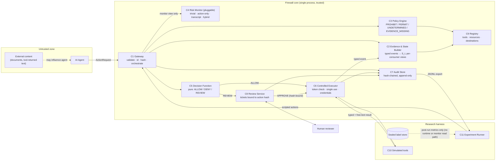
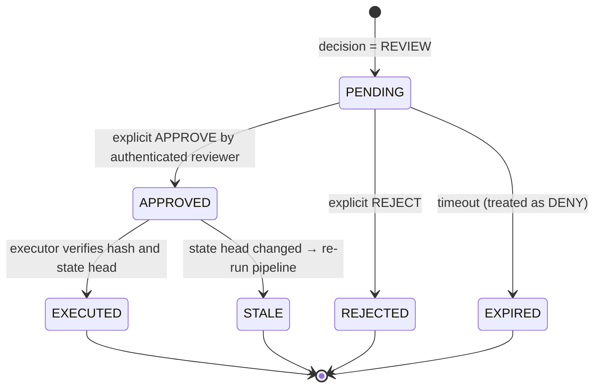
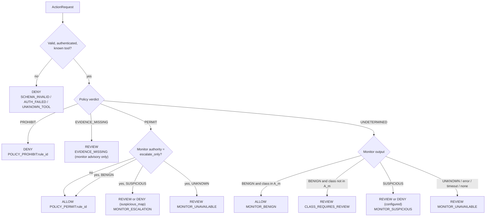

# 02 — System Architecture

**Status:** `PROPOSED`. Nothing here is implemented. Terminology: `00` §2. Threats and invariants: `01`. Formal decision function: `03` §4. Schemas and APIs: `05`. Requirement IDs: `04`.

---

## 1. Overview and what changed from the initial concept

The team's initial flow was: Agent → Gateway → Evidence/State → Policy → Risk Assessment → Decision → ALLOW/DENY/REVIEW → Controlled Execution → Audit/Dashboard. `[TEAM]`

I keep that flow but make these changes `[REC]`:

| Change | Reason |
|---|---|
| **Single in-process core library** (`FirewallCore`) with FastAPI as a thin adapter, not separate services. | Fewer failure modes, deterministic experiments, accurate latency attribution (`D-16`). |
| **Decision Engine is a pure function**, not a component with state. | Makes `INV-03/04/11` exhaustively testable (`03` §4). |
| **Added a Tool & Resource Registry (C9).** | Trusted source for classification, destination zone and tool sensitivity class; replaces regex-parsed text as the source of truth (`INV-07`). |
| **Policy engine owns hard prohibitions *including stateful ones*; monitors resolve only what rules leave undetermined.** | Keeps probabilistic components out of the authorization path for known violations (`INV-03`). |
| **Evidence/State Builder emits typed events with provenance tags.** | Defeats evidence spoofing in tool output (TS-05). |
| **Added Experiment Runner (C11) and Simulated Tool Environment (C10)** as first-class components. | The research claim lives or dies on reproducible evaluation. |
| **Human oversight is a minimal ticket mechanism in the MVP.** | Needed to satisfy `INV-05`; richer workload-aware routing deferred. |

---

## 2. Components

| ID | Component | Master-prompt ref | Responsibility | Owner (provisional) |
|---|---|---|---|---|
| C1 | **Runtime Interception Gateway** | A | Authenticate; validate `ActionRequest`; assign `action_id`, `seq`, canonical hash; serialize per session; orchestrate pipeline; return decision. | Akshat |
| C2 | **Evidence & State Builder** | B | Maintain typed event history; compute `S_t` as a pure fold over events; build per-consumer views (information barrier). | Shrishti (schema co-owned with Karishma) |
| C3 | **Permission & Policy Engine** | C | Evaluate versioned PROHIBIT/PERMIT rules over `(a_t, S_t, registry)` with three-valued logic; produce verdict and reason codes. | Karishma |
| C4 | **Runtime Risk Monitors** | D | Pluggable monitors behind one interface: trivial, action-only, transcript, hybrid. Return advisory assessments. | Shrishti |
| C5 | **Decision Function** | E | Combine gateway validity, policy verdict, monitor output and config into ALLOW/DENY/REVIEW with reason codes. Pure, side-effect-free. | Shared (Karishma + Akshat); reviewed by Shrishti |
| C6 | **Controlled Executor** | F | Verify authorization token against action hash and state head; execute exactly once; record outcome. Sole holder of tool credentials. | Akshat |
| C7 | **Audit & Evaluation Store** | G | Append-only hash-chained records; export JSONL; sealed label store (separate). | Snehal (store) + Shrishti (evaluation export) |
| C8 | **Human Review Service** | H | Create, track, resolve review tickets bound to action hash; expiry. | Snehal |
| C9 | **Tool & Resource Registry** | new | Tool schemas and sensitivity class; resource classifications; destination zones; versioned and read-only at runtime. | Karishma |
| C10 | **Simulated Tool Environment** | new | Deterministic tools and scenario backends. | Akshat (tools), Snehal (scenario fixtures) |
| C11 | **Experiment Runner** | new | Scenario generation, arm configuration, replay modes, metrics, statistics. | Shrishti, with independent test authors (`06` §5.3) |

---

## 3. Architecture diagrams

### 3.1 Component diagram



### 3.2 Runtime sequence

```mermaid
sequenceDiagram
    autonumber
    participant A as Agent
    participant G as C1 Gateway
    participant S as C2 State Builder
    participant P as C3 Policy Engine
    participant M as C4 Monitor
    participant D as C5 Decision Function
    participant U as C7 Audit Store
    participant R as C8 Review Service
    participant X as C6 Executor
    participant T as C10 Tools

    A->>G: ActionRequest
    G->>G: authenticate, validate schema, assign action_id/seq, canonical hash
    G->>U: append ACTION_RECEIVED
    G->>S: get state S_t and head hash
    S-->>G: S_t, head_hash
    G->>P: evaluate(a_t, S_t, registry, policy version)
    P-->>G: verdict V_t + rule ids + missing fields
    opt monitor consulted (V_t = UNDETERMINED, or escalate-only mode)
        G->>M: monitor view (projected, no labels)
        M-->>G: assessment (verdict, optional score + semantics) or timeout/error
    end
    G->>D: decide(valid, V_t, assessment, tool class, config)
    D-->>G: decision D_t + reason codes
    G->>U: append DECISION (versions, timings) — must succeed before continuing
    alt D_t = ALLOW
        G->>X: authorization token (action hash, head hash)
        X->>X: verify hash, head, unused, unexpired; mark used
        X->>T: execute action
        T-->>X: typed result + free text
        X->>S: append typed event (EXECUTED / FAILED)
        X->>U: append EXECUTION
        X-->>G: outcome
        G-->>A: ALLOWED + result
    else D_t = REVIEW
        G->>R: create ticket (PENDING) bound to action hash
        G-->>A: PENDING_REVIEW (nothing executed)
        R->>R: await explicit reviewer decision or expiry
        alt APPROVE (authenticated, hash-bound)
            R->>G: approved
            G->>X: authorization token
            X->>X: verify, execute once (as above)
        else REJECT or EXPIRED
            R->>S: append ACTION_DENIED event
            R->>U: append REVIEW_RESOLVED(denied)
        end
    else D_t = DENY
        G->>S: append ACTION_DENIED event
        G-->>A: DENIED + reason code
    end
```

### 3.3 Review ticket lifecycle



### 3.4 Decision flow (summary; canonical rules in `03` §4)



---

## 4. Responsibility matrix

| Capability | C1 | C2 | C3 | C4 | C5 | C6 | C7 | C8 | C9 |
|---|---|---|---|---|---|---|---|---|---|
| Authenticate / validate request | ● | | | | | | | | ○ |
| Assign ids, sequence, canonical hash | ● | | | | | ○ | | | |
| Hold observable history & compute `S_t` | | ● | | | | | ○ | | ○ |
| Source of classification / zone / tool class | | ○ | ○ | | | | | | ● |
| Hard prohibitions (incl. stateful) | | | ● | | | | | | ○ |
| Missing-evidence detection | | ● | ● | | | | | | |
| Risk assessment (advisory) | | | | ● | | | | | |
| Final ALLOW/DENY/REVIEW | | | | | ● | | | | |
| Execute exactly the authorized action | | | | | | ● | | | |
| Hold tool credentials | | | | | | ● | | | |
| Record decisions, versions, timings | ○ | | | | | ○ | ● | ○ | |
| Review tickets and approvals | | | | | | | ○ | ● | |
| Label isolation | | ● | | ○ | | | ● | | |

● primary · ○ participates

---

## 5. Data flows

| ID | From → To | Content | Trust handling |
|---|---|---|---|
| DF-1 | Agent → C1 | `ActionRequest` (tool, arguments, optional declared intent) | Untrusted. Agent-supplied ids/hashes ignored. `declared_intent` is logged but never used in decisions or reviewer summaries. |
| DF-2 | C1 ↔ C2 | Request state view; receive `S_t`, head hash | Trusted. |
| DF-3 | C1 → C3 | `(a_t, S_t, registry snapshot)` | Trusted. |
| DF-4 | C1 → C4 | **Monitor view** `x_t^{(m)}` — a projection defined per monitor (`03` §10) | Labels, future actions and test metadata excluded by construction. |
| DF-5 | C4 → C1 | Assessment (categorical verdict, optional score with declared semantics, rationale, raw text) | Untrusted data; strict parse; parse failure → `UNKNOWN`. |
| DF-6 | C1 → C5 | Decision inputs | Pure function call. |
| DF-7 | C1/C8 → C6 | Authorization token | Single-use, bound to hash and head. |
| DF-8 | C6 ↔ C10 | Tool call; typed result + free text | Typed fields from registry/gateway trusted; free text untrusted. |
| DF-9 | C6 → C2 | Typed event with provenance | Free text stored with provenance `TOOL_FREETEXT`, excluded from `S_t`. |
| DF-10 | all → C7 | Audit records | Append-only. |
| DF-11 | C8 ↔ reviewer | Gateway-generated summary; decision | Authenticated; agent-supplied text never shown as the summary. |
| DF-12 | C7 → C11 | JSONL export | Read-only. |
| DF-13 | Label store → C11 | Labels, post-run only | One-way; no runtime read path. |

---

## 6. State management

- **Event-sourced.** The authoritative record is the ordered event list per session. `S_t = Fold(H_t, registry)` is a pure function; there is no hidden mutable state (`INV-12`).
- **Events** are typed (`ACTION_RECEIVED`, `ACTION_DENIED`, `EXECUTED`, `FAILED`, `REVIEW_*`), each carrying provenance tags (`GATEWAY`, `REGISTRY`, `TOOL_TYPED`, `TOOL_FREETEXT`, `AGENT_CLAIM`). Only `GATEWAY`, `REGISTRY` and `TOOL_TYPED` fields may populate security-relevant parts of `S_t`.
- **State contents (data-export domain, proposed):** selected resources with classification (from registry), export jobs with destination zone (from registry), cumulative egress counters per zone, anomaly flags (e.g. `CONFLICTING_SELECTION`, `UNKNOWN_CLASSIFICATION`), head hash.
- **Binding mode (policy config).** `implicit` (as in [P1]: the last selected resource binds to the next export) or `explicit` (job references resource and destination by id). Both are supported to compare with [P1] and to assess realism (`OQ-06`).
- **Concurrency.** One in-flight action per session; a PENDING review blocks further actions in that session (`D-17`). Concurrent submissions receive `BUSY`.
- **Views.** C2 builds the information views per consumer: `PolicyView`, `MonitorView[m]`, `ReviewerView`. Views are plain data objects constructed from allow-lists of fields.

---

## 7. Execution control

1. Decision `ALLOW` (or an `APPROVE`) mints an `AuthorizationToken {action_id, action_hash, state_head_hash, decision_id, nonce, expires_at}`.
2. The executor re-computes the action hash from the stored request, compares it to the token, compares the current state head to the token's head, and atomically flips `used 0→1` in the database.
3. Only then does it call the tool. Success or failure is recorded as a typed event.
4. If the process dies after marking `used` but before recording the outcome, the action is recorded as `EXEC_UNKNOWN` and is **not** retried automatically (a retry is a new action with a new decision).
5. Tool credentials exist only in the executor's configuration (`A-01`).

---

## 8. Failure behaviour

| ID | Failure | Behaviour | Invariant |
|---|---|---|---|
| FB-01 | Schema invalid | `DENY SCHEMA_INVALID`; audited | INV-04 |
| FB-02 | Authentication failure | `DENY AUTH_FAILED` | INV-04 |
| FB-03 | Unknown tool | `DENY UNKNOWN_TOOL` (not REVIEW: the registry is the source of truth) | INV-04 |
| FB-04 | Policy/registry invalid at startup | Refuse to start | INV-10 |
| FB-05 | State builder error or hash-chain mismatch | `DENY STATE_UNAVAILABLE`; alert | INV-04, INV-09 |
| FB-06 | Policy engine exception | `DENY POLICY_ERROR` | INV-04 |
| FB-07 | Monitor timeout / error / unparseable output | Assessment `UNKNOWN` → `REVIEW MONITOR_UNAVAILABLE` when consulted | INV-04 |
| FB-08 | Audit write fails | Nothing executes; `DENY AUDIT_UNAVAILABLE` | INV-09 |
| FB-09 | Token hash/head mismatch or reuse | Executor refuses; pipeline may be re-run once (`STALE_DECISION`) | INV-02, INV-06 |
| FB-10 | Tool execution error | Record `FAILED`; no automatic retry | INV-02 |
| FB-11 | Review expired | `EXPIRED` ⇒ treated as DENY | INV-05 |
| FB-12 | Review rejected | `REJECTED` ⇒ DENY-equivalent | INV-05 |
| FB-13 | Concurrent action in session | `BUSY` | INV-02 |
| FB-14 | Required evidence missing for a sensitive tool | `REVIEW EVIDENCE_MISSING` | INV-04 |

---

## 9. Audit boundaries

- **Recorded before returning to the agent:** request, state head, policy verdict and rule ids, monitor identity/version/raw output/parsed verdict/timing, decision and reason codes, version hashes (contracts, policy, registry, monitor, prompt).
- **Recorded after execution:** outcome event, timings.
- **Never in the audit log:** secrets/credentials; ground-truth labels (separate sealed store).
- **Tamper evidence:** each record includes the previous record's hash (`INV-09`).
- **Separation** of *raw model output*, *parsed verdict* and *final decision* is mandatory (informed by [P3] §IV.F).
- Retention/redaction of sensitive payload content: minimal in MVP; flagged in `OQ-13`.

---

## 10. Mapping from paper concepts to modules

| Paper concept | Our module | Treatment |
|---|---|---|
| [P1] Observable FSM and state tuple | C2 + C3 stateful rules | Re-expressed over **typed** events (not regex over text); text-parsed variant kept as an ablation. |
| [P1] REVIEW on missing/conflicting evidence | C3 `EVIDENCE_MISSING` → C5 `REVIEW` | Adopted. |
| [P1] LLM monitor over serialized history | C4 `TranscriptMonitor` (arm B5) | Re-implemented under fair conditions; prompts developed on dev split. |
| [P1] Hybrid two-tier proposal | C4 `HybridMonitor` (arm P1) | To be evaluated, not assumed. |
| [P1] Action D invariance, matched filler | C10/C11 generator + invariance checker | Adopted as a test (`T-EXP-002`). |
| [P2] Layer 0 deterministic floor | C3 | Adopted. |
| [P2] Non-compensatory overrides | C5 monotone-strictness property | Adopted as a property rather than ad hoc rules. |
| [P2] CSI / GDS / AVTM, composite `R`, thresholds | — | **Deferred** (unvalidated; semantics differ from other papers). Registry classification replaces CSI in MVP. |
| [P2] TRANSFORM | — | Deferred (`OQ-17`). |
| [P2] O1/O2 overrides | C3 stateful rules | Refined: bind the *specific* resource to the *specific* sink. |
| [P3] T1 deterministic screening | C3 deny-list rules | Adopted as ordinary policy rules. |
| [P3] T2/T3 tiered LLM auditors | C4 resolver tiers (optional config) | Candidate cost control for the hybrid arm; `UNSURE` ⇒ `UNKNOWN` ⇒ `REVIEW`. |
| [P3] Early-acceptance (T2 PASS ⇒ allow) | — | **Rejected** (`R-02`). |
| [P3] Raw / parsed / final separation; error policy | C4, C7, FB table | Adopted. |
| [P4] CCS (confidence) | — | **Rejected for MVP** (`R-01`): confidence ≠ risk. |
| [P4] Queue `Q(t)`, rubber-stamping | C8 metrics; reviewer model in experiments | Measured only; no dynamic thresholds in MVP. |
| [P4] `T_min` mandatory review floor | C3 (`mandatory_review_classes`) | Adopted as static config. |
| [P4] Self-reflection fallback | — | **Rejected** (`R-08`): self-critique cannot replace human approval. |

---

## 11. Architectural decisions essential to the research hypothesis

| Decision | Why it is essential |
|---|---|
| Typed, attested state (`INV-07`) | Without it, the "deterministic stateful" baseline is attackable by text injection and not comparable to a monitor that reads text. |
| Information barrier and projected views | Fair comparison of baselines requires fixed information access (`03` §10). |
| Policy engine before models; monitors resolve only undetermined cases | Separates enforcement from estimation; allows the hybrid question to be asked cleanly. |
| Pure, exhaustively tested decision function | Makes "probabilistic output never overrides prohibition" a checked property. |
| Two evaluation modes (teacher-forced replay; open-loop enforcement) | Detection quality and prevention/utility need different protocols (`03` §9). |
| Sealed labels and per-consumer views | Prevents leakage (`INV-08`). |
| Audit export with versions and timings | Enables reproducible latency and error analysis. |

**Optional or deferrable:** FastAPI adapter (core runs in-process), hash chaining (cheap; strongly recommended), dashboard, review UI, embeddings, TRANSFORM, queue-aware routing.

---

## 12. Traceability to research objectives

| Research item | Components |
|---|---|
| RQ-1 / H1 (history necessity) | C2, C3 (stateless vs stateful), C4 (action-only vs transcript), C10/C11 |
| RQ-1 / H2 (state vs transcript) | C2, C3, C4 transcript, C11 |
| RQ-1 / H3 (robustness to perturbation) | C3, C4 hybrid, C9, C10 perturbation families |
| H4 (safety floor) | C3, C5, C6, C8 |
| H5 (cost) | C1 timing instrumentation, C7 |

Full chain to requirements, modules and tests: `07`.
