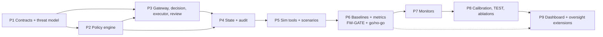

# 08 — Implementation Roadmap

**Current Status (as of Commit b30917b):** `IMPLEMENTED & VERIFIED`. All 9 implementation and evaluation phases have been completed; the repository has 433 passing automated tests and an operational runtime reference monitor.  
*Historical Note:* At initial project conception, this document was marked `PROPOSED (Implementation not started)`. The phase definitions, owners, and exit criteria below are preserved as permanent historical engineering records.

---

## 1. Principles

1. **Contracts first, shared by all four.** No module defines its own action, decision or state schema (`05` §3). Changes to `contracts/` need all four owners.
2. **Deterministic before probabilistic.** The deterministic stateful baseline (B6) is built and measured before any LLM monitor.
3. **Firewall before experiments.** No reportable result before FW-GATE (`04` §6): all `T-INV-01…12` pass in CI.
4. **Each phase ends with a demonstrable, tested artifact** and a short written exit check in `09`'s decision log.
5. **Test sets are written by people who do not build the methods** (`06` §5.3).
6. **Ordering deviations from the team's list** (flagged, `D-31`):
   - The policy engine (Phase 2) is tested against hand-built `SessionState` fixtures; its integration with the live state fold happens in Phase 4.
   - A minimal review-ticket mechanism ships in Phase 3, because `INV-05` is a security property; the review UI, queue analytics and workload-aware routing remain Phase 9.

---

## 2. Phases

### Phase 1 — Contracts and threat model (shared)

| Item | Detail |
|---|---|
| **Deliverables** | Approved `01`; `contracts/` v0.1.0 (enums, `ActionRequest`, `CanonicalAction`, `Event`, `SessionState`, `PolicyResult`, `MonitorView`, `MonitorAssessment`, `DecisionRecord`, `AuthorizationToken`, `ReviewTicket`); canonical hashing; golden JSON-Schema snapshot test; repo skeleton, CI (ruff, mypy, pytest), `CODEOWNERS`; written decisions on the Phase-1 open items below. |
| **Owners** | All four; Akshat (repo/CI), Shrishti (state/monitor models), Karishma (policy models), Snehal (review/audit models). |
| **Dependencies** | None. |
| **Exit criteria** | (1) Team approves `D-10`, `D-13`, `D-16`, `D-17`, `D-24`, `D-31` (Approved unanimously on 2026-10-29); (2) `T-GW-006` passes; (3) schema snapshot test passes in CI (verified 2026-10-29); (4) a one-page "policy semantics" example (`03` §3) walked through by all four with no unresolved disagreement; (5) the TEST-NOVEL families are chosen **and sealed** (hash only) before any monitor development (`06` §5.1). |
| **Risks** | Disagreement on binding mode or `MR` → mitigated by deciding in this phase (`OQ-06` open; `OQ-07` resolved via `D-13` approval). |

### Phase 2 — Deterministic policy engine and registry

| Item | Detail |
|---|---|
| **Deliverables** | `fw.policy`: rule loader, three-valued evaluator, verdict precedence; registry loader; policy files `policy_stateless.yaml`, `policy_stateful.yaml` implementing R1–R5 (`05` §7); decision-function skeleton may start here. |
| **Owner** | Karishma. Reviewer: Shrishti. |
| **Dependencies** | Phase 1 contracts. |
| **Exit criteria** | `T-POL-001…007` pass; Hypothesis property tests for dominance, evidence monotonicity and order independence run ≥ the budget fixed in Phase 1 with zero counterexamples; branch coverage ≥ 90% on `fw.policy`; full (classification × zone × setup-completeness) grid reproduces expected verdicts from fixtures. |
| **Risks** | Rule semantics drift from `03` §3 → code review against the truth table; `OQ-06` binding mode unresolved → implement both. |

### Phase 3 — Gateway, decision function, executor, minimal review

| Item | Detail |
|---|---|
| **Deliverables** | `fw.gateway`, `fw.core.submit`, `fw.decision` (pure `Δ`), `fw.executor` (tokens, hash/head checks, single use), `fw.review` (tickets, expiry), in-memory stand-ins for state and audit (replaced in Phase 4); optional FastAPI adapter. |
| **Owners** | Akshat (gateway, executor), Karishma + Akshat (decision), Snehal (review). |
| **Dependencies** | Phases 1–2. |
| **Exit criteria** | `T-GW-001…006`, `T-DEC-001…003`, `T-EXE-001…004`, `T-REV-001…005` pass; exhaustive `Δ` enumeration passes P-PROHIB, P-FAILCLOSED, P-MONO, P-NOLEAK; fuzz run of ≥ the pre-set budget produces **0** executions without a matching decision (`T-INV-01`) and **0** ALLOW results from injected faults (`T-INV-04`); branch coverage ≥ 90% on `fw.decision` and `fw.executor`. |
| **Risks** | Race conditions (TOCTOU) → single in-flight action per session (`D-17`), state-head check; Akshat bottleneck → Snehal pairs on executor tests. |

### Phase 4 — Observable state and audit logging

| Item | Detail |
|---|---|
| **Deliverables** | `fw.state` (event model, fold `Φ`, provenance tags, allow-listed views); `fw.audit` (SQLite WAL, hash chain, JSONL export, verification); integration of both into `core`; label store (separate file) and its import-graph guard. |
| **Owners** | Shrishti (state), Snehal (audit). |
| **Dependencies** | Phases 1–3. |
| **Exit criteria** | `T-STA-001…006`, `T-AUD-001…004` pass; `T-INV-07`, `T-INV-08`, `T-INV-09`, `T-INV-10`, `T-INV-12` pass; replay of ≥ 100 recorded sessions reproduces state with zero mismatches (`N` fixed here, `T-INV-12`); forged-classification fixtures leave the policy verdict unchanged. |
| **Risks** | State fold diverges between live and replay → single code path for both; sensitive payloads in logs → synthetic data only (`NFR-06`, `OQ-13`). |

### Phase 5 — Simulated tool environment and scenario generation

| Item | Detail |
|---|---|
| **Deliverables** | `fw.tools_sim` (deterministic tools with typed + free-text outputs); scenario generator and filler streams; label oracle (independent of policy); pair builder and Action-D invariance checker; family specs (`06` §3) for all MVP families; DEV and CAL splits; TEST-IN and TEST-NOVEL **specs written by Akshat and Snehal** and hash-committed. |
| **Owners** | Akshat (tools), Snehal (fixtures/specs, label audits), Shrishti (generator infrastructure only — not TEST content). |
| **Dependencies** | Phases 1–4. |
| **Exit criteria** | `T-EXP-001`, `T-EXP-002`, `T-EXP-005`, `T-EXP-009` pass; every history-dependent pair verified byte-identical at the critical action; independent label audit complete for ≥ the pre-set sample per family with all disagreements resolved and logged; TEST commitment hash committed to the repository; template counts per family recorded (`OQ-11`). |
| **Risks** | Labels mirror the policy engine → separate oracle and reviewer; scenario realism critique → disclosed limitation (`00` §8). |

### Phase 6 — Reproducible baselines and metrics

| Item | Detail |
|---|---|
| **Deliverables** | Arm manifests `B0…B3`, `B6`; runner with TF and OL modes; metrics and statistics modules; run manifests; first DEV-split report with error analysis; metric fixtures reproducing [P1] Table I and [P3] Table III. |
| **Owner** | Shrishti (runner/metrics); Karishma (arm manifests for policy arms). |
| **Dependencies** | Phase 5. |
| **Exit criteria** | `T-EXP-003`, `T-EXP-004`, `T-EXP-006…008`, `T-NFR-001` pass; **FW-GATE satisfied** (all `T-INV-01…12`); on DEV, `B0…B2` rows equal `03` §8.4; reruns of deterministic arms are bit-identical; H1 manipulation check shows `J = 0` for B3 on DEV history-dependent pairs; policy-fidelity diagnostics report B6's policy-FN/FP vs the oracle; **go/no-go review recorded in `09`** (if B6 already cleanly solves DEV, the team decides which later phases still address RQ-1 or whether to harden the benchmark first). |
| **Risks** | B6 saturates the benchmark (as in [P1]) and leaves no room to compare → include `PRT`, `BEN-08`, TEST-NOVEL, `ATK-05/07/08`, where a rule-based arm is expected to be imperfect; do not tune B6 to TEST-NOVEL. |

### Phase 7 — Context-aware monitors

| Item | Detail |
|---|---|
| **Deliverables** | `fw.monitors`: `ModelClient`, `ActionOnly`, `Transcript`, `Hybrid`; strict-JSON parser; timeout and fault wrappers; prompt files with hashes; DEV-split results for B4, B5, P1; replication check E-REP against [P1]'s reported pattern. |
| **Owner** | Shrishti. Reviewer: Karishma (decision-path integration); Akshat (fault injection). |
| **Dependencies** | Phase 6 and `OQ-12` (model/hosting/cost decision). |
| **Exit criteria** | `T-MON-001…007` pass; the equal-effort budget `K` and DEV selection criterion are written down **before** prompt iteration begins and followed; leakage canaries never appear in any prompt; injected monitor failures never produce ALLOW; prompts and model identifiers frozen only after DEV selection. |
| **Risks** | Model/API drift → pinned snapshot, recorded fixtures for CI; cost/time → cap repetitions via pre-registration; prompt over-tuning → equal-effort rule, no use of CAL/TEST. |

### Phase 8 — Calibration, held-out evaluation, ablations

| Item | Detail |
|---|---|
| **Deliverables** | Calibration (if any scored monitor) on CAL; `PREREG-001.md` (margins, sample sizes, budgets) tagged **before** TEST is run; single TEST run of all arms; ablations A-01…A-12 as prioritized in `06` §7; statistics; final report with all results, deviations, and limitations. |
| **Owner** | Shrishti (analysis), with all four reviewing the report; TEST authors audit labels one last time. |
| **Dependencies** | Phase 7. |
| **Exit criteria** | Pre-registration committed and tagged; TEST data untouched before tagging (verified by commit history and hash); `T-INV-01…12` still pass on the final frozen build; full run manifests archived with checksums; report includes every pre-registered outcome including unfavorable ones, error taxonomy results, and the limitations in `00` §8; no claim exceeds what the pre-registered tests support. |
| **Risks** | Temptation to re-tune after seeing TEST → stopping rules `06` §8.3; deviations disclosed; insufficient templates for power → state weaker claims (`03` §12.6). |

### Phase 9 — Dashboard and human-oversight extensions (deferred)

| Item | Detail |
|---|---|
| **Deliverables** | Audit/metrics dashboard (FR-DASH-01), review queue UI (FR-REV-05), optional queue-aware routing experiments and reviewer-fatigue sensitivity analysis (inspired by [P4] but not adopting its unvalidated parameters). |
| **Owner** | Snehal. |
| **Dependencies** | Phase 8 complete (or at minimum Phase 6 exit for a read-only audit viewer). |
| **Exit criteria** | Dashboard renders audit export for ≥ 1 full run without altering any record; review UI cannot approve an action other than the ticketed one (`T-REV-005` still passes); any dynamic-threshold experiment is pre-registered separately. |
| **Risks** | Scope creep pulling time from Phases 6–8 → no dashboard work before Phase 6 exit, except a read-only audit viewer. |

---

## 3. Dependency graph

---

## 4. Integration points

| ID | Interface | Producer → Consumer | Frozen in | Contract test |
|---|---|---|---|---|
| IP-1 | `ActionRequest` / `CanonicalAction` / hash | Gateway → all | Phase 1 | T-GW-006, schema snapshot |
| IP-2 | `SessionState`, `Event` | State → Policy, Monitors, Review | Phase 1 (fields), Phase 4 (behavior) | T-STA-001, T-STA-003 |
| IP-3 | `PolicyResult` | Policy → Decision | Phase 1 | T-POL-007, T-DEC-001 |
| IP-4 | `MonitorView` / `MonitorAssessment` | Core ↔ Monitors | Phase 1 (schema), Phase 7 (behavior) | T-MON-001, T-MON-007 |
| IP-5 | `DecisionRecord`, `AuthorizationToken` | Decision/Gateway → Executor, Audit | Phase 1 | T-EXE-001, T-AUD-002 |
| IP-6 | `ReviewTicket`, `ReviewerView` | Gateway → Review → Executor | Phase 1 | T-REV-001…005 |
| IP-7 | Audit JSONL export | Audit → Experiment runner/dashboard | Phase 4 | T-AUD-004 |
| IP-8 | Scenario spec / label store | Generator → Runner (labels post-run only) | Phase 5 | T-EXP-005, T-AUD-003 |

---

## 5. Cross-cutting ownership

| Area | Primary | Secondary |
|---|---|---|
| Contract changes | all four (unanimous) | — |
| CI and invariant tests | Akshat | Karishma |
| Policy semantics and Hypothesis tests | Karishma | Shrishti |
| Metrics code and statistics | Shrishti | Snehal (independent re-check of one metric per phase) |
| Scenario TEST specs and label audits | Akshat and Snehal (cross) | — |
| Documentation upkeep (`00`–`09`) | rotating weekly owner | — |
| Decision log entries | whoever proposes; approval by team | — |

Ownership is provisional (`D-01`). Shared responsibility: nobody merges changes to `contracts/`, `fw.decision` or `fw.executor` without a second reviewer.

---

## 6. Project-level risks

| ID | Risk | Likelihood / impact (judgment) | Mitigation |
|---|---|---|---|
| RK-1 | Team capacity < plan (students, concurrent coursework) | High / High | Phase 6 go/no-go; stretch items explicitly droppable; fixed minimum deliverable = Phases 1–6 |
| RK-2 | Deterministic baseline already solves the benchmark → little to compare | Medium / Medium | Include perturbation, novel and spoofing families; report honestly if B6 suffices (a valid finding) |
| RK-3 | LLM cost/latency limits repetitions | Medium / Medium | Local or low-cost model option; recorded fixtures; pre-registered `R_llm` |
| RK-4 | Test-set leakage through authorship overlap | Medium / High | `§5.3` procedures; disclosure |
| RK-5 | Contract drift between owners | Medium / High | Single `contracts/` package, CODEOWNERS, schema snapshots |
| RK-6 | Over-claiming | Medium / High | Reporting rules (`06` §8.3); every claim cites test and metric (`07`) |
| RK-7 | Scope creep (dashboard, workload routing, scoring formulas) | High / Medium | Deferred list (`04` §8); phase gates |
| RK-8 | Novelty already published | Unknown / Medium | Literature tasks L-1…L-3 (`00` §6), scheduled in Phase 1–2 |

---

## 7. Gate checklist between phases

Before starting Phase *n+1*, the owner of Phase *n* records in `09` §6: the exit criteria met (with test IDs and commit hashes), deviations from this roadmap, new open questions, and approval by at least one other team member.
