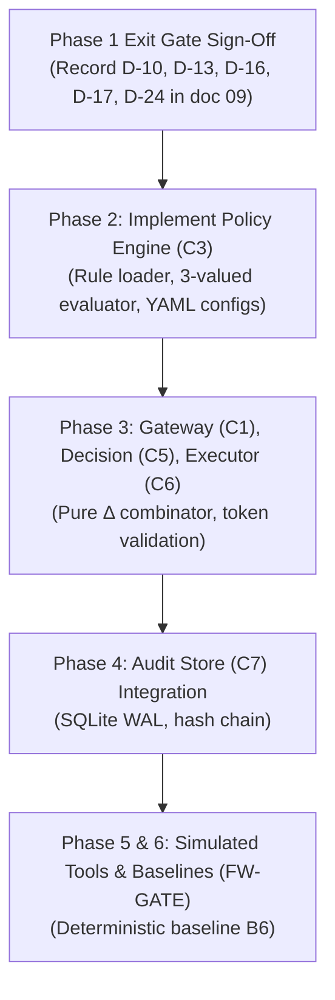

# Comprehensive Project Audit & Implementation Status Report

**Date of Audit:** October 29, 2026  
**Auditor:** Antigravity AI Architecture & Security Team  
**Repository:** `ai-agent-permission-firewall`  
**Current Branch:** `main` (commit `8749a3d`)  
**Specification References:** `docs/00` through `docs/09`, `docs/C2_SECURITY_AUDIT.md`, `docs/SEC_01_02_REMEDIATION_DESIGN.md`  

---

## 1. Executive Summary & Health Scorecard

The **AI Agent Permission Firewall** is a research-grade security architecture designed to enforce deterministic runtime permission boundaries on autonomous AI agents, mediating tool calls with three-valued policy evaluation, observable state tracking, and optional context-aware risk monitors.

### High-Level Status: **Phase 1 Complete / Phase 2 Blocked**
* **Completed Foundation:** Core contracts, cryptographic hashing, deterministic state engine ($C_2$), and cryptographic evidence verification are fully implemented with **61 passing tests (100%)**.
* **Resolved Schema Golden Snapshot:** `test_contracts_golden_schema_snapshot` is resolved; JSON schema golden snapshot is synchronized byte-for-byte with Pydantic v2 schemas.
* **Unimplemented Core Firewall:** The Policy Engine ($C_3$), Gateway ($C_1$), Decision Function ($C_5$), Controlled Executor ($C_6$), Audit Store ($C_7$), Review Service ($C_8$), and Baseline Runner ($C_{11}$) are completely unbuilt (`0` bytes or empty directories).
* **Imported Rejection-Cascade Artifacts:** PR #1 merged empirical scripts and benchmark results from an external pilot study into `experiments/`, but these bypass the formal firewall architecture and use raw Ollama calls.

### Scorecard

| Area | Status | Progress | Notes |
|---|---|:---:|---|
| **Contracts & Threat Model (Phase 1)** |  Complete | 100% | Models, hashing, and golden schema snapshot tests pass 100%. |
| **Deterministic Policy Engine (Phase 2)** | ❌ Not Started | 0% | `src/firewall/policy/` empty; config YAMLs are 0 bytes. |
| **Gateway, Decision, Executor (Phase 3)** | ❌ Not Started | 0% | `core.py`, `decision/`, `executor/`, `review/` empty. |
| **Observable State & Evidence (Phase 4)** |  Substantially Built | 85% | $C_2$ functional fold & HMAC evidence verifier complete; SQLite audit store missing. |
| **Simulated Tools & Scenarios (Phase 5)** | ❌ Not Started | 0% | `src/firewall/tools/sim/` empty; datasets empty. |
| **Baselines & Evaluation Runner (Phase 6)** | ⚠️ External Pilot Only | 15% | Formal runner missing; pilot scripts in `experiments/scripts/`. |
| **Context-Aware Monitors (Phase 7)** | ❌ Not Started | 0% | `src/firewall/monitor/` empty. |
| **Calibration, TEST, Ablations (Phase 8)** | ⏳ Pending Phase 7 | 0% | Blocked on phases 2–7. |
| **Dashboard & Oversight UI (Phase 9)** | 💤 Deferred | 0% | Explicitly deferred per `D-06` / `D-28`. |

---

## 2. Component Implementation Status ($C_1$ – $C_{11}$)

| Component ID | Component Name | Module Path | Implemented? | Implementation Details & Gaps |
|---|---|---|:---:|---|
| **Contracts** | Canonical Schemas & Hashes | `src/firewall/contracts/` |  **YES** | `enums.py`, `hashing.py` (RFC 8785 canonical bytes), and `models.py` implemented. Schema snapshot test verified and passing. |
| **C1** | Interception Gateway | `src/firewall/core.py`, `interceptor/` | ❌ **NO** | `core.py` is 0 bytes. `interceptor/` is empty. No request validation, action hashing orchestration, or session lifecycle. |
| **C2** | Evidence & State Builder | `src/firewall/state/` |  **YES** | `engine.py`, `evidence.py`, `registry.py`, `views.py` fully implemented with HMAC-SHA256 verification and information barriers. |
| **C3** | Policy Engine | `src/firewall/policy/` | ❌ **NO** | Directory empty. Rules R1–R5 and three-valued evaluation not implemented. |
| **C4** | Runtime Risk Monitors | `src/firewall/monitor/` | ❌ **NO** | Directory empty. No pluggable `ModelClient`, `ActionOnly`, `Transcript`, or `Hybrid` monitors in the firewall package. |
| **C5** | Pure Decision Function ($\Delta$) | `src/firewall/decision/` | ❌ **NO** | Directory empty. Formal combinator $\Delta(v, m, c, s)$ not implemented. |
| **C6** | Controlled Executor | `src/firewall/executor/` | ❌ **NO** | Directory empty. Single-use token validation, credential isolation, and execution gating not implemented. |
| **C7** | Audit & Evaluation Store | `src/firewall/audit/` | ❌ **NO** | Directory empty. Hash-chained SQLite WAL store and JSONL export missing. |
| **C8** | Human Review Service | `src/firewall/oversight/` | ❌ **NO** | Directory empty. Ticket lifecycle, hash-bound approvals, and expiry missing. |
| **C9** | Tool & Resource Registry | `src/firewall/state/registry.py` | ⚠️ **PARTIAL** | Python registry classes implemented in `state/registry.py`; `config/registry.yaml` is 0 bytes. |
| **C10** | Simulated Tool Environment | `src/firewall/tools/sim/` | ❌ **NO** | Directory empty. No deterministic mock tools (`execute_export`, etc.). |
| **C11** | Experiment Runner & Metrics | `experiments/` | ⚠️ **PARTIAL** | Spec files `evaluate.py`, `metrics.py`, `stats.py`, `run_experiment.py` are 0 bytes. Ad-hoc scripts exist in `experiments/scripts/`. |
| **API** | Thin FastAPI Adapter | `src/firewall/api/` | ❌ **NO** | Directory empty. (Optional stretch goal per `D-16`). |

---

## 3. Test Suite & Invariant Verification Status

### Test Run Summary (`pytest -v`)
- **Total Tests Discovered:** 61
- **Passed:** 61
- **Failed:** 0
- **Pass Rate:** 100.0%

### Breakdown by Test Category

1. **Unit Tests (`tests/unit/`):**
   - `test_ci_label_leakage.py`: 4 tests passed (validates CI isolation rules).
   - `test_contracts.py`: 9 tests passed (validates models, enum members, forbidden extra fields).
   - `test_hashing.py`: 7 tests passed (validates RFC 8785 canonical bytes, float rejection, unicode normalization).
   - `test_state_engine.py`: 30 tests passed (comprehensive state fold tests, adversarial tests for SEC-01/02/03).
   - `test_schema_snapshot.py`:  **1 PASSED** (`test_contracts_golden_schema_snapshot` verified byte-for-byte against golden snapshot).
2. **Invariants Tests (`tests/invariants/`):**
   - `test_security_invariants_contracts.py`: 2 tests passed (model immutability, enum stability).
   - `test_security_invariants_state.py`: 6 tests passed (`INV-04`, `INV-07`, `INV-08`, `INV-12` on State Engine).
3. **Property Tests (`tests/property/`):**
   - `test_hashing_properties.py`: 2 tests passed (Hypothesis property tests for hash stability).
4. **Empty Test Directories:**
   - `tests/integration/` (0 tests)
   - `tests/scenarios/` (0 tests)
   - `tests/security/` (0 tests)

### Security Invariants Verification Matrix

| Invariant | Description | Target Component | Verifying Test(s) | Status |
|---|---|---|---|---|
| **INV-01** | Complete Mediation | Gateway ($C_1$), Executor ($C_6$) | `T-INV-01`, `T-GW-005` | ❌ **Unimplemented** |
| **INV-02** | Decision-Action Binding | Executor ($C_6$), Contracts | `T-INV-02`, `T-EXE-001` | ❌ **Unimplemented** |
| **INV-03** | Hard-Prohibition Supremacy | Policy ($C_3$), Decision ($C_5$) | `T-INV-03`, `T-DEC-001` | ❌ **Unimplemented** |
| **INV-04** | Fail-Closed on Faults | All components | `test_inv_04_fail_closed_on_broken_continuity` | ⚠️ **Verified on State only** |
| **INV-05** | Review Non-Authorization | Review ($C_8$), Decision ($C_5$) | `T-INV-05`, `T-REV-001` | ❌ **Unimplemented** |
| **INV-06** | Single-Use Authorization | Executor ($C_6$) | `T-INV-06`, `T-EXE-002` | ❌ **Unimplemented** |
| **INV-07** | Evidence Provenance Barrier | State ($C_2$) | `test_inv_07_untrusted_provenance_barrier` |  **Verified & Closed** |
| **INV-08** | Label & Test Isolation | State Views ($C_2$), Monitors ($C_4$) | `test_inv_08_view_information_barrier_and_canary_isolation` | ⚠️ **Verified (Partial - Transcript view pending)** |
| **INV-09** | Audit Completeness & Tamper Evidence | Audit ($C_7$) | `T-INV-09`, `T-AUD-001` | ❌ **Unimplemented** |
| **INV-10** | Versioned Decisions | Audit ($C_7$), Policy ($C_3$) | `T-INV-10`, `T-AUD-002` | ❌ **Unimplemented** |
| **INV-11** | Monotone Strictness | Decision ($C_5$) | `T-INV-11`, `T-DEC-001` | ❌ **Unimplemented** |
| **INV-12** | Deterministic Core & Replay | State ($C_2$), Policy ($C_3$) | `test_inv_12_deterministic_core_and_replay_identity` | ⚠️ **Verified on State only** |

---

## 4. Security Audit & Remediation Status (`C2_SECURITY_AUDIT.md`)

| Finding | Severity | Description | Resolution Status |
|---|---|---|---|
| **SEC-01** | CRITICAL | Unverified `EvidenceReceipt` cryptographic signature & bindings | **RESOLVED & CLOSED** (`HmacEvidenceVerifier` in `src/firewall/state/evidence.py`). |
| **SEC-02** | HIGH | Structural provenance tag substitution bypass | **RESOLVED & CLOSED** (Loose tags deprecated for egress; requires verified receipt). |
| **SEC-03** | HIGH | Missing `session_id` on `SessionState` caused cross-session splicing | **RESOLVED & CLOSED** (`expected_session_id` mandatory in `apply_event` & `replay_events`). |
| **SEC-04** | MEDIUM | Undocumented state-head hash preimage specification | **OPEN / HELD** (`D-36` proposed in `09_DECISIONS_AND_OPEN_QUESTIONS.md`). |
| **SEC-05** | LOW | Incomplete transcript serialization in `views.py` | **OPEN** (`format_transcript` omits tool name/args). |
| **SEC-06** | LOW | Conflicting selection in implicit mode overwrites `bound_resource` | **OPEN** (Requires policy specification clarification). |
| **SEC-07** | LOW | Export execution without destination increments `UNKNOWN` without anomaly | **OPEN** (Should record `Anomaly.UNKNOWN_DESTINATION`). |

---

## 5. Decisions & Open Questions Status (`09_DECISIONS_AND_OPEN_QUESTIONS.md`)

### Confirmed Decisions (from brief)
- `D-01` to `D-09`, `D-10b`: Confirmed team roles, Python/Pydantic stack, SQLite audit, no Redis/microservices, 3 decision outcomes, dashboard deferred.

### Key Proposed Decisions Awaiting Approval
- **`D-10` (Adopt RQ-1):** Team vote required to formally adopt RQ-1 and hypotheses H1–H5 alongside RQ-0.
- **`D-13` / `OQ-07` (Mandatory Review & Egress Authority):** Whether research arms let monitors evaluate `EGRESS_EXTERNAL` actions to benchmark against [P1].
- **`D-16` (Single-Process FirewallCore):** Keep gateway and decision engine in a single in-process Python library; FastAPI as a thin wrapper.
- **`D-17` (Session Serialization):** Strictly one in-flight action per session (`BUSY` state during review).
- **`D-24` / `OQ-08` (Missing Evidence Handling):** Monitor can resolve `UNDETERMINED` but can never relax `EVIDENCE_MISSING` or `PROHIBIT`.
- **`D-33`, `D-34`, `D-35`:** Verified and closed during SEC-01/SEC-02 remediation.
- **`D-36`:** State-head preimage specification formalization (Held pending team reproduction).

### Open Questions (OQs) Requiring Resolution
1. **Resolved:** `OQ-01` (Akshat verified [P3] rejection routing and held-out dataset).
2. **Phase 1 Urgent:**
   - `OQ-06`: Tool argument binding mode (implicit, explicit, or both?).
   - `OQ-07`: Egress external monitor authority.
   - `OQ-19`: Team capacity, submission deadlines, and academic targets.
3. **Phase 2:**
   - `OQ-15`: Literature review tasks L-1 to L-3 (novelty verification).
   - `OQ-21`: Formal Anomaly enum expansion vs open strings in `SessionState.anomalies`.
4. **Phase 3 & 4:**
   - `OQ-22`: Cryptographic key rotation scheme (`key_id` in `EvidenceReceipt`).
   - `OQ-23`: Replay log provenance anchoring (WORM / signed checkpoints).
   - `OQ-13`: Payload retention/redaction in audit logs.
5. **Phase 5 & 7:**
   - `OQ-11`: Power analysis and template counts per family.
   - `OQ-12`: LLM model selection, hosting (local Ollama vs API), and cost budget.

---

## 6. Audit of `experiments/` and Rejection-Cascade Artifacts

In commit `8749a3d`, pull request #1 (`integrate-rejection-cascade`) was merged. 

### Current State of `experiments/`:
1. **Formal Research Pipeline Modules (`evaluate.py`, `metrics.py`, `run_experiment.py`, `stats.py`):**
   - All **0 bytes**. None of the formal metrics ($M\text{-ADR}, M\text{-APR}, M\text{-FPR-T}, M\text{-LTS}, M\text{-LAT}$) or runner infrastructure are implemented.
2. **Imported Pilot Scripts (`experiments/scripts/`):**
   - 21 scripts were imported (e.g. `ablation_study.py`, `adaptive_security_test.py`, `routing_audit.py`).
   - These scripts invoke local Ollama endpoints directly (`http://localhost:11434/api/generate` with `llama3.2` and `llama3`) and do not go through `src/firewall/contracts/` or `src/firewall/state/`.
   - Results are stored in raw CSV files (`ablation_results.csv`, `results.csv`, `results_full_study.csv`).
3. **Data & Labels Isolation:**
   - `experiments/datasets/dev` and `test` directories exist but are currently empty.
   - `labels/` directory is empty.
   - CI check `scripts/ci_check_no_labels.py` is operational and passing.

---

## 7. Immediate Actionable Roadmap & Priority Blockers

### Top Immediate Priorities:
1. **Execute Phase 1 Exit Gate:**
   - Hold team review to formally approve decisions `D-10`, `D-13`, `D-16`, `D-17`, `D-24`, `D-31`.
   - Document approval in `docs/09_DECISIONS_AND_OPEN_QUESTIONS.md §6`.
2. **Commence Phase 2 (Deterministic Policy Engine):**
   - Implement `src/firewall/policy/` (rule loader, three-valued evaluator `PERMIT / PROHIBIT / UNDETERMINED / EVIDENCE_MISSING`).
   - Create `config/policy_stateless.yaml` and `config/policy_stateful.yaml` implementing rules R1–R5.
3. **Commence Phase 3 (Core Interception & Decision):**
   - Implement `core.py`, pure `decision/`, and single-use token `executor/`.
