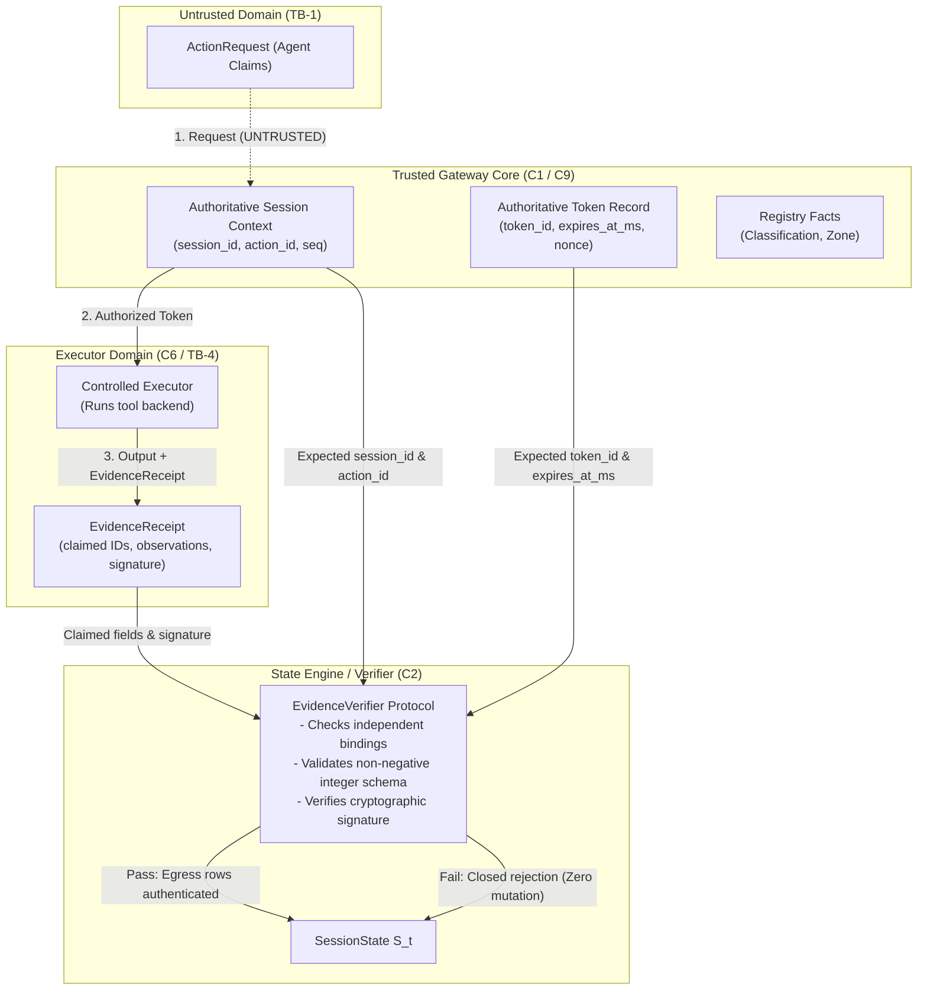

# SEC-01 & SEC-02 Remediation Design (Final Revision)

**Document ID:** `DESIGN-SEC-01-02-FINAL`  
**Current Status:** `PROPOSED — AWAITING TEAM APPROVAL`  
**Author:** AI/ML Runtime Risk & State Engine Owner  
**Target Milestone:** State Engine Hardening & Gateway Integration ($C_1 / C_2 / C_6$)  
**Governing Documents:** [docs/01_THREAT_MODEL.md](file:///d:/Desktop/ai-agent-permission-firewall/docs/01_THREAT_MODEL.md), [docs/02_SYSTEM_ARCHITECTURE.md](file:///d:/Desktop/ai-agent-permission-firewall/docs/02_SYSTEM_ARCHITECTURE.md), [docs/05_TECHNICAL_SPEC.md](file:///d:/Desktop/ai-agent-permission-firewall/docs/05_TECHNICAL_SPEC.md), [docs/09_DECISIONS_AND_OPEN_QUESTIONS.md](file:///d:/Desktop/ai-agent-permission-firewall/docs/09_DECISIONS_AND_OPEN_QUESTIONS.md)

---

## 1. Executive Summary & Scope

This document provides the final, implementation-ready architectural design for closing:
1. **SEC-01 (Evidence Receipt Authentication)**: Cryptographic signature verification, authoritative binding validation, strict observation filtering, and fail-closed handling for [EvidenceReceipt](file:///d:/Desktop/ai-agent-permission-firewall/src/firewall/contracts/models.py#L241-L250).
2. **SEC-02 (Provenance Authenticity)**: Rejection of caller-forged `TaggedValue` provenance tags, enforcement of the ingestion trust boundary, and deprecation of loose dictionary payload fields for egress mutation.

### Strict Scope & Governance Status
- **Review Status**: **CONDITIONALLY ACCEPTED (PROPOSED pending verification)**.
- **Decision Outcomes**:
  - `D-33`: Accepted HMAC-SHA256 for MVP with explicit same-process key-protection and trust-boundary limits.
  - `D-34`: Accepted strict egress evidence for `execute_export`.
  - `D-35`: Accepted decoupling of live evidence freshness from deterministic historical replay.
  - `D-36`: Held pending independent reproduction of state-head preimage, canonical serialization, and expected hash against the actual implementation.
  - `OQ-23`: External integrity anchoring remains open as a documented architectural limitation.
- **Pre-Merge Requirement**: Adversarial test cases must be validated against the real implementation rather than only the proposed design. Status remains `PROPOSED — AWAITING TEAM APPROVAL` until verification is complete.
- **Security Standard**: Passing tests are necessary, but not sufficient, for security sign-off.
- **Source Integrity**: No implementation code has been written in `src/`, no frozen contracts modified, and golden schema snapshots remain untouched.

---

## 2. Verifier Trust Boundary & Authoritative Input Authentication

### 2.1 Input Mapping & Component Authority

The evidence verifier operates at the junction between the Controlled Executor ($C_6$), the Trusted Gateway ($C_1$), and the State Builder ($C_2$). Inputs originate from distinct architectural entities with strictly defined trust levels:

| Input Entity | Source Component | Trust Level | Ingestion Authority & Verification Role |
| :--- | :--- | :--- | :--- |
| **`ActionRequest`** | Untrusted AI Agent ($C_{\text{agent}}$) via `TB-1` | **UNTRUSTED** | Agent inputs, arguments, declared intent. **Never authoritative**. Injected `"provenance"` tags are stripped at ingestion. |
| **Gateway Session Context** | Trusted Gateway ($C_1$) | **AUTHORITATIVE** | Authoritative `session_id`, sequentially assigned `action_id`, monotonic sequence `seq`, canonical `action_hash`, wall-clock `ingestion_timestamp_ms`. |
| **Authorization Token Record** | Trusted Gateway / DB `tokens` table | **AUTHORITATIVE** | Authoritative `token_id`, `action_id`, `action_hash`, `state_head_hash`, `nonce`, `expires_at_ms`. |
| **Controlled Executor** | Controlled Executor ($C_6$) via `TB-4` | **ISOLATED / CREDENTIALED** | Alone holds execution credentials (`A-01`). Executes authorized action, measures exact output (`rows`, `bytes`), constructs and signs [EvidenceReceipt](file:///d:/Desktop/ai-agent-permission-firewall/src/firewall/contracts/models.py#L241-L250). |
| **Registry** | Registry Service ($C_9$) via `A-05` | **AUTHORITATIVE** | Authoritative resource classifications and destination zones. Immutable at runtime (`INV-07`). |
| **`EvidenceReceipt`** | Executor Output attached to Execution Event | **UNAUTHENTICATED UNTIL VERIFIED** | Contains claimed `session_id`, `action_id`, `token_id`, `source_tool_name`, `observed_state`, `observed_timestamp_ms`, and `signature`. |



### 2.2 Independent Binding Validation
The verifier authenticates receipt fields against **independently trusted expected values** supplied by the Gateway context, **NEVER** using values sourced solely from the receipt:
1. **Session Binding**: `receipt.session_id == expected_session_id == event.session_id`.
2. **Action Binding**: `receipt.action_id == expected_action_id == event.action_id`.
3. **Token Binding**: `receipt.token_id == expected_token_id == event.token_id`.
4. **Tool Name Binding**: `receipt.source_tool_name == event.payload["tool"] == "execute_export"`.

### 2.3 Strict Observation Schema Validation
To prevent buffer rollbacks, precision confusion, and type evasion:
- **Exact Integer Type**: In Python, `isinstance(True, int)` evaluates to `True`. The verifier must explicitly enforce:
  $$\text{type}(v) \text{ is int and not isinstance}(v, \text{bool})$$
- **Non-Negative Range**: $v \ge 0$.
- **Prohibition of Floats & Ambiguity**: Floating-point numbers, booleans, negative integers, numeric strings, and `None` are strictly rejected with `VerificationFailureReason.INVALID_OBSERVATION`.

---

## 3. Atomicity & Anomaly Representation Architecture

### 3.1 Strict State Atomicity on Verification Failure
A failed transition attempt **NEVER** mutates the input [SessionState](file:///d:/Desktop/ai-agent-permission-firewall/src/firewall/contracts/models.py#L101-L115) instance in memory:
$$\Phi(S_{t-1}, e_{\text{invalid}}) \implies \text{Exception Raised},\quad S_{t-1} \text{ remains 100\% bit-for-bit identical}$$
- `head_hash` does NOT change.
- `seq` does NOT increment.
- `egress_counters` are NOT updated.
- `anomalies` list is NOT mutated in place.
- `indeterminate_state` is NOT incremented in place.

### 3.2 Dual-Channel Rejection Architecture
To resolve the contradiction between state immutability and security monitoring:
1. **Security Audit Channel (Primary)**:
   Verification failures are rejected atomically and logged directly to the trusted append-only audit store ($C_7$, `audit_records` table) with `type = "EXECUTION_VERIFICATION_FAILED"`. The in-memory `SessionState` remains untouched.
2. **State Anomaly Channel (Explicit State Transition Only)**:
   If a security incident must be reflected in `SessionState` (e.g. to be observable by downstream policy rules), it MUST occur via a **separate, explicit, integrity-protected state transition event** emitted by the trusted Gateway (e.g., an `ACTION_DENIED` event with sequence $seq_t = seq_{t-1} + 1$ and $prior\_head_t = head\_hash_{t-1}$).

### 3.3 Reassessment of Freeform Strings in `SessionState.anomalies`
- **Current Code Usage**:
  - `src/firewall/contracts/enums.py:121` defines `Anomaly(str, Enum)` with **only three members**: `CONFLICTING_SELECTION`, `UNKNOWN_CLASSIFICATION`, and `UNKNOWN_DESTINATION`.
  - While `SessionState.anomalies: list[str]` allows arbitrary strings, inserting uncoordinated freeform strings (such as `"FORGED_EVIDENCE_RECEIPT"` or `"EXPIRED_EVIDENCE"`) risks policy fragility: policy rules checking string containment can fail on minor naming variations.
- **Architectural Decision**:
  - Verification failures belong in the **trusted security audit log**, not in `SessionState.anomalies`.
  - Freeform strings will **NOT** be added to `SessionState.anomalies` for receipt verification failures unless explicitly mandated by an approved policy rule.
  - An open question (`OQ-21`) is submitted to the team regarding whether `Anomaly` enum should be formally expanded in Phase 3.

---

## 4. Reconciling State-Head Hashing & Preimage Specification

### 4.1 Exact Implementation Formula
In [src/firewall/state/engine.py:69-109](file:///d:/Desktop/ai-agent-permission-firewall/src/firewall/state/engine.py#L69-L109), `compute_state_head()` is implemented as:
```python
def compute_state_head(prior_head: str, event_data: Any) -> str:
    canonical_bytes = canonical_json(event_data, reject_floats=False)
    hasher = hashlib.sha256()
    hasher.update(prior_head.encode("utf-8"))
    hasher.update(canonical_bytes)
    return hasher.hexdigest()
```
For a [StateEventEnvelope](file:///d:/Desktop/ai-agent-permission-firewall/src/firewall/contracts/models.py#L229-L239), `event_data` is serialized by `_extract_event_canonical_data()` into the dictionary:
```json
{
  "action_id": "act_0004",
  "event_type": "EXECUTED",
  "payload": { ... },
  "prior_head": "a3f8...",
  "seq": 2,
  "session_id": "sess_01",
  "token_id": "tok_0004"
}
```

### 4.2 Reconciled State-Head Formula
The exact canonical head hash is:
$$\text{head\_hash}_t = \text{SHA-256}\left( \text{prior\_head}_{t-1}\text{.encode('utf-8')} \parallel \text{canonical\_json}(\text{event\_data}_t, \text{reject\_floats}=\text{False}) \right)$$

**Key Reconciliations:**
1. **Prior-Head Double Binding**: `prior_head` is hashed both as a direct UTF-8 byte prefix to the SHA-256 hasher AND as an internal dictionary entry in `event_data["prior_head"]`.
2. **Payload Enclosure**: `payload` contains the full canonical dictionary of [EvidenceReceipt](file:///d:/Desktop/ai-agent-permission-firewall/src/firewall/contracts/models.py#L241-L250) (including its `signature`). Thus, `head_hash` cryptographically covers the evidence receipt and signature.
3. **Audit Chain Consistency**: This structure directly aligns with `05_TECHNICAL_SPEC.md §6` (`audit_records.hash = SHA-256(prev_hash || canonical_json(payload))`).
4. **Resolution of SEC-04**: The dictionary preimage defined in `engine.py` is formalized and submitted for team sign-off under proposal `D-36`.

### 4.3 Deterministic State-Head Hash Test Vector Proposal (D-36)
To ensure independent implementation and cross-language verification, the following deterministic test vector is established:

- **Input Parameters**:
  - `session_id`: `"sess_test_vector_001"`
  - `prior_head` (computed via `compute_genesis_head("sess_test_vector_001")`):  
    `"800112320e761601448f48f314d5065c201f5e589b49805625e27ad763e6629d"`
  - `event`: `StateEventEnvelope` with sequence 1:
    ```json
    {
      "action_id": "act_0001",
      "event_type": "EXECUTED",
      "payload": {
        "arguments": {
          "resource_ref": "res_alpha"
        },
        "tool": "select_resource"
      },
      "prior_head": "800112320e761601448f48f314d5065c201f5e589b49805625e27ad763e6629d",
      "seq": 1,
      "session_id": "sess_test_vector_001",
      "token_id": "tok_0001"
    }
    ```
- **Exact Canonical JSON Bytes** (RFC 8785 UTF-8 decoded):
  `{"action_id":"act_0001","event_type":"EXECUTED","payload":{"arguments":{"resource_ref":"res_alpha"},"tool":"select_resource"},"prior_head":"800112320e761601448f48f314d5065c201f5e589b49805625e27ad763e6629d","seq":1,"session_id":"sess_test_vector_001","token_id":"tok_0001"}`
- **Exact Canonical Bytes Hex**:
  `7b22616374696f6e5f6964223a226163745f30303031222c226576656e745f74797065223a224558454355544544222c227061796c6f6164223a7b22617267756d656e7473223a7b227265736f757263655f726566223a227265735f616c706861227d2c22746f6f6c223a2273656c6563745f7265736f75726365227d2c227072696f725f68656164223a2238303031313233323065373631363031343438663438663331346435303635633230316635653538396234393830353632356532376164373633653636323964222c22736571223a312c2273657373696f6e5f6964223a22736573735f746573745f766563746f725f303031222c22746f6b656e5f6964223a22746f6b5f30303031227d`
- **Expected Resulting SHA-256 State-Head Hash**:
  `dbdd59223ada423eda4eb02b12078d3ec33e0f30b75f81414b9a575c75c6da17`

---

## 5. Timestamp Boundaries & Validation Rules

### 5.1 Exact Timestamp Boundaries

```
Past Skew Window (30s)                Future Skew Window (5s)
[-----------------------------|--------------]
now_gw - 30,000 ms         now_gw        now_gw + 5,000 ms
```

1. **Receipt Timestamp vs. Token Expiry (Inclusive Boundary)**:
   $$\text{receipt.observed\_timestamp\_ms} \le \text{token.expires\_at\_ms}$$
   - If `observed_timestamp_ms == token.expires_at_ms`: **VALID** (inclusive boundary).
   - If `observed_timestamp_ms > token.expires_at_ms`: **REJECTED** with `VerificationFailureReason.EXPIRED_EVIDENCE`.
2. **Gateway Freshness Window (Live Ingestion Only)**:
   $$t_{\text{gw}} - 30\,000\,\text{ms} \le \text{receipt.observed\_timestamp\_ms} \le t_{\text{gw}} + 5\,000\,\text{ms} \quad (\text{both inclusive})$$
   - **Rationale for 5-Second Future Tolerance**:
     In distributed execution architectures, slight clock skew between the executor host and gateway host (or network transit buffering) can cause a receipt to arrive with a timestamp marginally ahead of the gateway's instantaneous wall clock. A narrow 5-second window accommodates legitimate clock drift without enabling time-travel attacks.
   - **Exact Boundaries**:
     - If `observed_timestamp_ms < t_gw - 30_000`: REJECTED with `VerificationFailureReason.STALE_EVIDENCE_TIMESTAMP`.
     - If `observed_timestamp_ms > t_gw + 5_000`: REJECTED with `VerificationFailureReason.FUTURE_EVIDENCE_TIMESTAMP`.
3. **Missing or Unreliable Gateway Time**:
   If the Gateway host clock is uninitialized, stepping backwards, or unsynchronized via NTP, the Gateway **FAILS CLOSED** (`INV-04`). Tokens cannot be issued, and receipts cannot be ingested.
4. **Historical Replay Decoupling**:
   During `replay_events()`, the live $30\text{s}$ past and $5\text{s}$ future freshness window is **STRICTLY BYPASSED**. The replay verifier evaluates `observed_timestamp_ms <= token.expires_at_ms` against the historical token record, preserving replay across arbitrary elapsed time.

---

## 6. Historical Replay Trust & Audit Chain Provenance

### 6.1 Limits of the Hash Chain Alone
> [!WARNING]
> **A hash chain alone does NOT authenticate the event producer against wholesale rewriting.**
> An adversary with write access to the storage volume can rewrite the entire audit log from genesis, recomputing internally valid hash chain links $H'_t = \text{SHA-256}(H'_{t-1} \parallel \text{event}'_t)$.

### 6.2 Multi-Record Validation During Replay
During historical replay, `replay_events()` reconstructs state trust by validating cross-record integrity across authoritative audit entities:
1. **Action-to-Event Integrity**: For each execution event, `action_hash` in the corresponding action record matches `compute_action_hash(session_id, seq, tool, args)`.
2. **Authorization Token Binding**: The authorization token recorded at authorization matches `token_id`, `action_id`, `action_hash`, was issued before execution, and satisfies `receipt.observed_timestamp_ms <= token.expires_at_ms`.
3. **Cryptographic Signature Verification**: Recomputes HMAC over the receipt preimage using the historical key recorded in `config_versions` active during that session sequence.
4. **Strict Invariant Checks**: Verifies monotonic sequence ($seq_t = seq_{t-1} + 1$), prior-head continuity ($prior\_head_t = head\_hash_{t-1}$), and authoritative session identity ($session\_id_t == expected\_session\_id$).

### 6.3 Unresolved Integration Requirement: External Integrity Anchoring (`OQ-23`)
To guarantee non-repudiation and prevent wholesale log rewriting in production, the system requires an **external integrity checkpoint**:
- Periodic signing of `head_hash` by a hardware security module (HSM) or dedicated authority key.
- Anchoring checkpoints to an append-only transparency log or WORM (Write-Once-Read-Many) storage.
- **Status:** Recorded as an **unresolved Phase 3/4 integration requirement** (`OQ-23`).

---

## 7. HMAC Key Isolation & Trust Limits

### 7.1 Single-Process Architecture Limits
In the MVP architecture (`D-16`), the Gateway ($C_1$), State Engine ($C_2$), and Controlled Executor ($C_6$) run in a single Python process:
- **Zero Memory Isolation**: In Python, all threads and modules share the same heap and environment (`os.environ`). Private attributes (such as `self._hmac_key`) and closure variables are accessible via introspection (`_ClassName__attribute`, `gc.get_objects()`, `inspect`, or `ctypes`). **Private Python attributes do NOT provide a security boundary against in-process code.**
- **HMAC Trust Boundary**: HMAC is symmetric. It authenticates that the receipt was constructed by an entity possessing the secret key. **It provides zero cryptographic isolation between the Gateway and the Executor.**

### 7.2 Mitigation & Security Assumption for MVP
To safely operate under HMAC in MVP:
1. **Assumption `A-03` Governs**: The host OS, Python process, and local environment are trusted (`01_THREAT_MODEL.md §9`).
2. **Strict Sandboxing for Untrusted Code**: Agent-controlled inputs, prompt text, and third-party tool drivers run exclusively within the research harness sandbox (`C10`) and cannot execute arbitrary Python code in the core process.
3. **Key Encapsulation**: The key is stored within `HmacEvidenceVerifier` and is never exposed in API views, reviewer tickets, or transcripts (`INV-08`).

### 7.3 Asymmetric Migration Trigger (Ed25519)
The team SHALL migrate to Ed25519 when:
- The Controlled Executor ($C_6$) is moved out-of-process into remote workers, containers, or microservices.
- At that point, the private key $SK_{\text{exec}}$ resides exclusively on the executor node, while the Gateway and State Engine hold only the public key $PK_{\text{exec}}$.

---

## 8. Replay Protection & Token Lifecycle (Integration Scope)

> [!NOTE]
> Database-level atomic token consumption is an integration requirement for the future Gateway ($C_1$) and Persistence ($C_7$) layers. It is **NOT** implemented in the pure in-memory state engine ($C_2$), and no collections have been added to frozen contracts.

### 8.1 Database-Level Atomic CAS
Per `docs/05_TECHNICAL_SPEC.md §6`, token single-use is enforced via atomic CAS in SQLite/PostgreSQL:
```sql
UPDATE tokens
SET used = 1, used_at_ms = :now_ms
WHERE token_id = :token_id
  AND used = 0
  AND expires_at_ms >= :now_ms;
```
If `rows_affected == 0`, execution is aborted immediately with `TOKEN_ALREADY_USED` or `TOKEN_EXPIRED`. The tool backend is never invoked.

### 8.2 Crash Recovery Contract
- **One In-Flight Action Rule (`D-17`)**: Each session permits only one active action at a time (`in_flight_action_id` in `sessions` table). Concurrent requests receive HTTP `409 Conflict (BUSY)`.
- If the system crashes after tool execution but before audit write: the token remains `used = 1`. Client retries fail closed. The Gateway reconciles the action as `EXEC_UNKNOWN` or completes the pending event from the WAL.

---

## 9. Provenance Authenticity Enforcement (SEC-02)

1. **Ingestion Sanitization (`TB-1`)**: All parameters from `ActionRequest.arguments` are unconditionally tagged by the Gateway as `Provenance.AGENT_CLAIM`. Injected `"provenance"` tags are stripped.
2. **Registry Primacy (`INV-07`, `A-05`)**: Classifications and destination zones are loaded strictly from `Registry.get_resource_classification(ref)` and `Registry.get_destination_zone(ref)`. Free-text assertions have zero effect.
3. **Deprecation of Loose Tagged Values**: For `execute_export`, egress row and byte counters MUST be updated **exclusively** from an authenticated [EvidenceReceipt](file:///d:/Desktop/ai-agent-permission-firewall/src/firewall/contracts/models.py#L241-L250). Loose dictionary fields (`payload["fields"]["rows"]`, `payload["rows"]`) are completely ignored.

---

## 10. Comprehensive Adversarial Test Matrix

| Test ID | Test Name | Attack Vector / Scenario | Expected Firewall Outcome |
| :--- | :--- | :--- | :--- |
| **`ADV-01`** | `test_sec_01_forged_receipt_signature_rejected` | Corrupted signature or signed with wrong HMAC key. | Verification fails with `INVALID_SIGNATURE`; state unchanged; 0 egress rows. |
| **`ADV-02`** | `test_sec_01_wrong_session_receipt_binding_rejected` | Valid receipt for Session A attached to event in Session B. | Fails closed with `BINDING_MISMATCH_SESSION`; state unchanged; 0 egress rows. |
| **`ADV-03`** | `test_sec_01_wrong_action_or_token_binding_rejected` | Receipt with `action_id="act_1"` or `token_id="tok_1"` attached to event for `act_2` / `tok_2`. | Fails closed with `BINDING_MISMATCH_ACTION/TOKEN`; state unchanged. |
| **`ADV-04`** | `test_sec_01_wrong_tool_name_binding_rejected` | Receipt from `validate_schema` attached to an `execute_export` event. | Fails closed with `BINDING_MISMATCH_TOOL`; state unchanged. |
| **`ADV-05`** | `test_sec_01_negative_or_boolean_observation_rejected` | `observed_state={"rows": -10}` or `{"rows": True}` or `{"rows": 12.5}`. | Fails closed with `INVALID_OBSERVATION`; state unchanged; 0 egress rows. |
| **`ADV-06`** | `test_sec_01_expired_or_stale_receipt_rejected` | `observed_timestamp_ms` exceeds token expiry or live freshness threshold. | Fails closed with `EXPIRED_EVIDENCE` or `STALE_EVIDENCE_TIMESTAMP`. |
| **`ADV-07`** | `test_sec_01_missing_verifier_fails_closed` | `apply_event()` invoked on export event when verifier is `None`. | Fails closed with `MISSING_VERIFIER_OR_KEY`; raises `EvidenceVerificationError`. |
| **`ADV-08`** | `test_sec_02_caller_forged_tool_typed_provenance_rejected` | Caller injects `TaggedValue(value=100, provenance=TOOL_TYPED)` in payload without a receipt. | Egress counters remain 0; loose payload ignored; fails closed. |
| **`ADV-09`** | `test_sec_01_historical_replay_skips_wallclock_freshness` | Replay events from 180 days ago with valid signatures and sequence. | Replay succeeds deterministically; `head_hash` matches bit-for-bit. |
| **`ADV-10`** | `test_sec_01_failed_transition_preserves_state_atomically` | Deep equality comparison of `SessionState` before and after failed transition attempt. | Input state instance is 100% bit-for-bit identical; no fields mutated. |

---

## 11. Proposed Decisions & Open Questions

### 11.1 Proposed Decisions (Awaiting Team Approval)

| ID | Title | Proposal Statement | Rationale | Alternatives |
| :--- | :--- | :--- | :--- | :--- |
| **D-33** | Evidence Verification Abstraction | Introduce `EvidenceVerifier` Protocol in `src/firewall/state/evidence.py`, with default `HmacEvidenceVerifier`. | Decouples cryptographic implementation from state transition logic. | Hardcode HMAC directly in `engine.py`. |
| **D-34** | Strict Egress Evidence Requirement | Mandate that `execute_export` egress counters are updated ONLY from verified `EvidenceReceipt`. Loose `TaggedValue` dictionary entries are deprecated for egress. | Closes SEC-02 provenance tag forging vulnerability. | Continue trusting loose `TOOL_TYPED` tags. |
| **D-35** | Replay Wall-Clock Decoupling | Historical replay verifies signatures and bindings, but bypasses live wall-clock freshness ($30\text{s}$). | Preserves deterministic audit log replay across arbitrary time spans (`INV-12`). | Re-evaluate wall clock (fails replay). |
| **D-36** | State-Head Preimage Formalization | Formalize the `StateEventEnvelope` dictionary preimage schema implemented in `engine.py:82-93` into `05_TECHNICAL_SPEC.md §4`. | Closes audit finding SEC-04; establishes canonical state-head hashing. | Redesign preimage dictionary. |

### 11.2 Open Questions & Unresolved Issues

| ID | Topic | Unresolved Issue | Proposed Action |
| :--- | :--- | :--- | :--- |
| **OQ-21** | Anomaly Enum Scope | `Anomaly` enum in `contracts/enums.py` lacks security verification flags (`FORGED_EVIDENCE_RECEIPT`, etc.). | Record verification failures in the audit store ($C_7$). Do not alter `enums.py` or frozen schemas without team vote. |
| **OQ-22** | Key ID in Receipt | `EvidenceReceipt` currently lacks `key_id: Optional[str]`. | Use single active key for Phase 1/2; decide if `key_id` is required before Phase 3 production freeze. |
| **OQ-23** | Replay Log Provenance Anchoring | The hash chain alone does not protect against wholesale log rewriting without external anchoring. | Evaluate periodic signed checkpointing or WORM storage for Phase 3/4 integration. |

---

## 12. Verification & Integrity Checklist

- [x] **Design Documents Updated**: [docs/SEC_01_02_REMEDIATION_DESIGN.md](file:///d:/Desktop/ai-agent-permission-firewall/docs/SEC_01_02_REMEDIATION_DESIGN.md), [docs/09_DECISIONS_AND_OPEN_QUESTIONS.md](file:///d:/Desktop/ai-agent-permission-firewall/docs/09_DECISIONS_AND_OPEN_QUESTIONS.md), [docs/05_TECHNICAL_SPEC.md](file:///d:/Desktop/ai-agent-permission-firewall/docs/05_TECHNICAL_SPEC.md).
- [x] **Source Code (`src/`)**: Untouched for this revision (clean).
- [x] **Frozen Contracts (`src/firewall/contracts/`)**: 100% preserved (clean).
- [x] **Golden Schema Snapshot**: Untouched and verified (clean).
- [x] **Verification Checks**: All 49 existing tests, Ruff linting, and mypy type checks pass with exit code 0.
