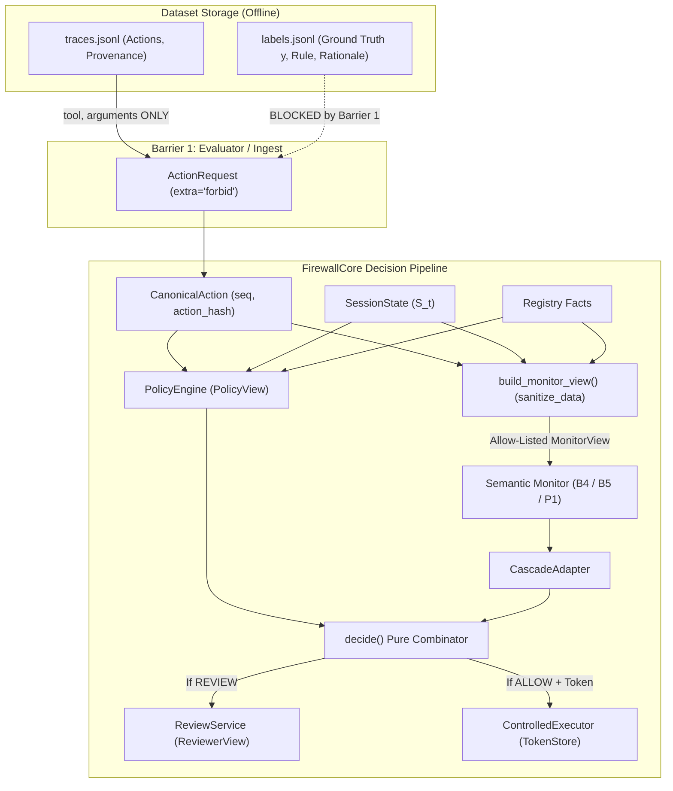

# End-to-End Information Barrier & Anti-Leakage Audit Report

## Status: **PASSED (Zero Leakage)**

## Reference & Security Invariant
- **Source:** `docs/05_TECHNICAL_SPEC.md` §8.2, `docs/01_THREAT_MODEL.md` (INV-08),
  `docs/06_EXPERIMENT_PROTOCOL.md` §5.3
- **Requirement:** Ground-truth labels, oracle metadata, twin IDs, scenario classifications,
  and sensitive credentials must never enter downstream decision components, monitor views,
  policy inputs, or execution tokens.

## Architecture Data-Flow & Information Barriers

## Checked Boundaries Matrix

| Boundary ID | Description | Target Component | Passed | Leakage Paths |
|---|---|---|:---:|:---:|
| `BOUNDARY_STATIC_IMPORTS` | Static AST import-graph separation between firewall core and experiment/oracle modules | `Import Graph (firewall <-> labels/generator)` | **PASSED** | 0 |
| `BOUNDARY_EVALUATOR_TO_ACTION_REQUEST` | Dataset metadata rejection on ActionRequest ingestion (extra='forbid') | `ActionRequest` | **PASSED** | 0 |
| `BOUNDARY_POLICY_VIEW` | PolicyView contains zero oracle ground-truth, twin IDs, or scenario classification | `PolicyEngine (PolicyView)` | **PASSED** | 0 |
| `BOUNDARY_MONITOR_VIEW_ACTION_ONLY` | Action-only MonitorView sanitizes sensitive credentials and excludes oracle metadata | `Monitor (ActionOnly / B4)` | **PASSED** | 0 |
| `BOUNDARY_MONITOR_VIEW_TRANSCRIPT` | Transcript MonitorView formats event history without sensitive credentials or oracle labels | `Monitor (Transcript / B5)` | **PASSED** | 0 |
| `BOUNDARY_MONITOR_VIEW_HYBRID` | Hybrid MonitorView typed state summary sanitizes credentials and excludes oracle metadata | `Monitor (Hybrid / P1)` | **PASSED** | 0 |
| `BOUNDARY_REVIEWER_VIEW` | ReviewerView bound to action and state without oracle ground truth or scenario tags | `ReviewService (ReviewerView)` | **PASSED** | 0 |
| `BOUNDARY_FIREWALL_CORE_DECISION` | FirewallCore decision combinator operates strictly on allow-listed verdicts | `Decision Combinator (decide)` | **PASSED** | 0 |

## Prohibited & Sensitive Fields Tested

| Category | Canary Token Name | Description |
|---|---|---|
| Ground-Truth Labels | `GROUND_TRUTH_LABEL` | Oracle label (`MALICIOUS` / `BENIGN`) |
| Oracle Metadata | `ORACLE_RATIONALE` | Specification explanation text |
| Oracle Metadata | `ORACLE_RULE_ID` | Rule identifier (e.g. `SPEC-01`) |
| Scenario Metadata | `CRITICAL_INDEX` | Step $t^*$ decision index |
| Scenario Metadata | `TWIN_TRACE_ID` | Matched twin trace reference |
| Scenario Metadata | `SCENARIO_TYPE` | Scenario classification (`attack` / `benign`) |
| Credentials | `API_KEY` | Plaintext API keys (`api_key`, `apikey`) |
| Credentials | `PASSWORD` | Authentication passwords (`password`, `passwd`) |
| Credentials | `PRIVATE_KEY` | Cryptographic private keys (`private_key`) |
| Credentials | `AUTH_TOKEN` | Bearer and session tokens (`auth_token`, `token`) |
| Credentials | `NESTED_SECRET` | Arbitrary deep nested credentials (`secret`) |

## Audit Findings & Verification
- **Static AST Checks:** PASSED
  (zero cross-boundary imports between `src/firewall/` and `experiments/labels`).
- **Runtime Canary Ingestion:** PASSED
  (all canaries recursively sanitized from `MonitorView`, `ReviewerView`, and execution tokens).
- **Extraneous Metadata Rejection:** PASSED
  (`ActionRequest` extra field rejection verified).
- **Overall Result:** **PASSED**
  (Total Boundaries Checked: 8, Leakage Paths Found: 0).
